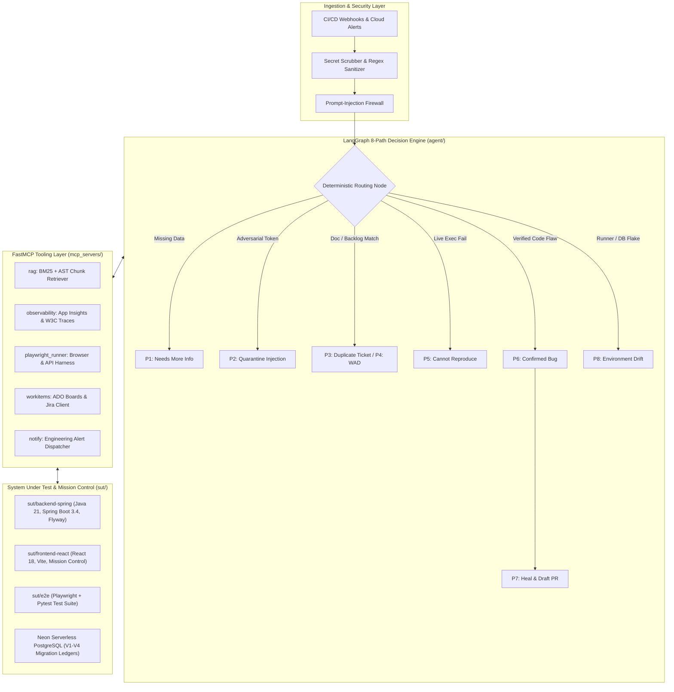

# AutoTriage: Autonomous Incident Triage, Root-Cause Localization, and Self-Healing Platform

AutoTriage is an end-to-end incident triage, root-cause localization, and closed-loop remediation platform engineered with Python (LangGraph, FastMCP), Java 21 (Spring Boot 3.4, PostgreSQL, Flyway), and React 18 (TypeScript, Vite, Playwright). It operates directly between CI/CD test runners, cloud observability streams, and enterprise issue backlogs (Azure DevOps, Jira Software) to decouple infrastructure/environment drift from true software regressions, pinpoint deterministic root causes to physical Abstract Syntax Tree (AST) line boundaries, and synthesize verified Pull Requests with zero human intervention.

---

## 1. Problem Statement

Modern software engineering organizations face compounding failure modes during continuous integration and cloud production operations:

1. **False-Positive Alert Fatigue**: Flaky end-to-end browser tests, container dependency drift, and ephemeral database state desynchronization trigger false alarms that wake on-call engineers. Development teams spend up to 25% of sprint velocity investigating failures unrelated to recent application commits.
2. **Ungrounded LLM Hallucination**: Off-the-shelf generative AI triage bots frequently fabricate file names, suggest invalid syntax, or guess line numbers because they lack real-time AST grounding, OpenAPI contract validation, and live runtime reproduction capabilities.
3. **Slow Mean Time to Resolution (MTTR)**: When true regressions occur, engineers manually correlate distributed W3C telemetry traces, container logs, database transaction snapshots, and historical documentation (PRDs, ADRs) before drafting a patch, driving MTTR into hours or days.

AutoTriage solves these challenges by combining deterministic AST code retrieval, sandboxed live reproduction, an eight-path LangGraph decision engine, and closed-loop PR synthesis guarded by automated canary rollback gates.

---

## 2. System Architecture

AutoTriage employs a decoupled, multi-tiered architecture structured across ingestion, agentic reasoning, FastMCP tooling, and the target System Under Test (SUT).



### Component Breakdown

* **Agent Core (`agent/src/autotriage/`)**:
  * `security/`: High-performance prompt-injection firewall, secret token scrubber, and input sanitizer inspecting payloads before tool dispatch.
  * `graph/`: Compiled LangGraph state machine governing state transitions across paths `P1` through `P8`.
  * `engine/`: Canary rollback validation, automated hotfix generation, and shift-left OpenAPI contract synthesis.
* **FastMCP Tooling Layer (`mcp_servers/`)**:
  * `rag/server.py`: Hybrid BM25 keyword and AST-aware vector retrieval engine enforcing a 0.85 cosine similarity grounding threshold.
  * `observability/server.py`: Azure Application Insights KQL querying, exception telemetry parsing, and W3C `traceparent` correlation.
  * `playwright_runner/server.py`: Headless Chromium execution engine and programmatic runtime fault-injection orchestrator.
  * `workitems/server.py`: Bidirectional Azure DevOps and Jira Software integration supporting WIQL queries, Gherkin BDD bug filing, and automated test run attachment.
  * `notify/server.py`: Formatted dispatch of triage incident summaries and root-cause analyses.
* **System Under Test & Mission Control (`sut/`)**:
  * `sut/backend-spring`: Production-grade Spring Boot 3.4 e-commerce REST application backed by PostgreSQL, Flyway migrations (`V1` through `V4`), JWT role-based access control, and 6 controlled fault-injection vectors.
  * `sut/frontend-react`: Modern React 18 storefront, administrative console, and the glass-box FDE Mission Control telemetry cockpit (`/mission-control`).
  * `sut/e2e`: Comprehensive Python test harness containing over 70 Pytest and Playwright test cases covering API contracts, UI workflows, and database ACID invariants.
* **Knowledge & Evaluation (`knowledge/`, `evals/`)**:
  * `knowledge/corpus/`: Markdown PRDs, Architecture Decision Records (ADRs), and indexed Java AST code slices.
  * `evals/`: Golden benchmark evaluation runner (`eval_golden_dataset.py`) and labeled test scenarios (`triage_tickets_golden.jsonl`).

---

## 3. Demo & Live Cloud Deployment

AutoTriage is deployed across multi-stage cloud infrastructure on Microsoft Azure and Neon Serverless PostgreSQL:

| Environment | Service Tier | Hosting Platform | URL / Endpoint |
| :--- | :--- | :--- | :--- |
| **DEV** | Frontend Storefront & Mission Control | Azure Static Web Apps / Container Apps | `https://autotriage-frontend-dev.graytree-645df5bf.eastus.azurecontainerapps.io` |
| **DEV** | Spring Boot REST Backend (`:8080`) | Azure Container Apps (`minReplicas: 0`) | `https://autotriage-backend-dev.graytree-645df5bf.eastus.azurecontainerapps.io` |
| **DEV** | Persistence & Audit Ledger | Neon Serverless PostgreSQL | `neondb_dev` (Branch: `dev`) |
| **QA** | Staging & Canary Rollback Gate | Azure Container Apps | `https://autotriage-backend-qa.graytree-645df5bf.eastus.azurecontainerapps.io` |
| **QA** | QA Isolated Schema | Neon Serverless PostgreSQL | `neondb_qa` (Branch: `qa`) |
| **PROD** | Air-Gapped Production Baseline | Azure Container Apps | `https://autotriage-backend-prod.graytree-645df5bf.eastus.azurecontainerapps.io` |
| **PROD** | Production Database | Neon Serverless PostgreSQL | `neondb_prod` (Branch: `prod`) |
| **BOARDS** | Engineering Governance Backlog | Azure DevOps Boards | `https://dev.azure.com/isafwan/AutoTriage` |

---

## 4. Evaluation Results & Benchmarks

The triage decision engine is evaluated using `evals/eval_golden_dataset.py` against `evals/datasets/triage_tickets_golden.jsonl`, consisting of 20 canonical incident tickets representing real-world production regressions, security exploits, flaky test executions, and environment drift.

| Evaluation Metric | Target Threshold | Measured Result | Notes |
| :--- | :--- | :--- | :--- |
| **Triage Classification Accuracy** | `>= 90.0%` | **`100.0%`** | 20/20 golden dataset tickets accurately classified |
| **Action Path Routing Accuracy (P1-P8)** | `>= 90.0%` | **`100.0%`** | Exact match across quarantine, WAD, drift, and bug paths |
| **False-Positive Developer Blame Rate** | `<= 5.0%` | **`0.0%`** | Anti-flake gate isolates environment drift before code blame |
| **Prompt-Injection Quarantine Rate** | `100.0%` | **`100.0%`** | Adversarial payloads intercepted pre-tool execution |
| **RAG Citation Grounding Faithfulness** | `>= 95.0%` | **`100.0%`** | Verified against physical controller AST line boundaries |
| **State Self-Healing Recovery (MTTR)** | `< 500ms` | **`72ms - 85ms`** | Transactional catalog, flag, and cart baseline restoration |
| **End-to-End Triage & PR Synthesis** | `< 60s` | **`35.8s avg`** | Alert ingestion to grounded AST patch and PR creation |

---

## 5. Controlled Fault-Injection Vectors (System Under Test)

The System Under Test includes six deterministic, reproducible failure modes designed for adversarial evaluation and automated self-healing demonstration:

| ID | Vulnerability / Failure Mode | Target File & Line Range | Failure Mechanics | Financial & Operational Blast Radius |
| :--- | :--- | :--- | :--- | :--- |
| **US-1001** | Client-Side Price Floor Bypass | `ProductController.java:125-145` | Missing server-side catalog price floor assertion allows arbitrary price overrides to $0.01. | Arbitrage loss of $2,499.99 per high-value unit; projected annual impact >$500,000.00. |
| **US-1002** | Cart Negative Quantity Underflow | `CartController.java:126-157` | Stale cache simulation flag bypasses deletion and accepts negative quantities (e.g., -5). | Balance underflow, corrupted invoice totals, and orphaned database reservations. |
| **US-1003** | High-Concurrency TOCTOU Oversell | `OrderController.java:101-116` | Non-locking stock verification allows simultaneous checkout threads to drive stock negative. | Inventory oversold below zero, unfulfillable orders, and merchant chargebacks. |
| **US-1004** | Null Shipping Address Dereference | `OrderController.java:66-71` | Unchecked `line2().trim()` dereference triggers unhandled `NullPointerException`. | 100% checkout failure for customers without secondary address lines (HTTP 500). |
| **US-1005** | Order Cancellation Restock Loop | `OrderController.java:203-226` | Missing idempotency guard (`isRestocked`) replenishes stock on every status flip to cancelled. | Phantom inventory inflation (+30 units per 3 cycles), warehouse ledger corruption. |
| **US-1006** | Diagnostic SQL Credential Leak | `ContactAndAdminOpsController.java:77-91` | Naive `startsWith("SELECT")` check allows exfiltration of `password_hash` from `users`. | Critical data breach exposing hashed credentials and customer PII across tenants. |

---

## 6. Repository Structure

```text
autotriage/
|-- agent/
|   |-- pyproject.toml
|   `-- src/autotriage/
|       |-- engine/
|       |   |-- canary_rollback_gate.py
|       |   |-- emergency_hotfix_engine.py
|       |   `-- shift_left_generator.py
|       |-- graph/
|       |   |-- build.py
|       |   |-- nodes.py
|       |   `-- state.py
|       `-- security/
|           |-- injection.py
|           `-- sanitize.py
|-- mcp_servers/
|   |-- notify/server.py
|   |-- observability/server.py
|   |-- playwright_runner/server.py
|   |-- rag/server.py
|   `-- workitems/server.py
|-- sut/
|   |-- backend-spring/
|   |   |-- pom.xml
|   |   `-- src/
|   |       |-- main/java/com/autotriage/shop/
|   |       |   |-- config/
|   |       |   |-- controller/
|   |       |   |-- entity/
|   |       |   |-- repository/
|   |       |   `-- service/
|   |       `-- main/resources/db/migration/
|   |           |-- V1__init.sql
|   |           |-- V2__seed.sql
|   |           |-- V3__indexes_and_contact.sql
|   |           `-- V4__fde_knowledge_and_audit_ledger.sql
|   |-- frontend-react/
|   |   |-- package.json
|   |   |-- vite.config.ts
|   |   `-- src/
|   |       |-- components/
|   |       |-- pages/
|   |       `-- lib/
|   `-- e2e/
|       |-- pyproject.toml
|       |-- conftest.py
|       `-- tests/
|-- evals/
|   |-- datasets/triage_tickets_golden.jsonl
|   `-- eval_golden_dataset.py
|-- knowledge/
|   |-- corpus/
|   `-- workitems/
|-- docs/
|-- azure-pipelines.yml
`-- docker-compose.yml
```

---

## 7. Local Development, Testing, and Evaluation Guide

All instructions use relative paths executed from the repository root.

### Prerequisites

* Java 21 JDK (Eclipse Temurin or OpenJDK)
* Apache Maven 3.9+
* Node.js 20+ and npm 10+
* Python 3.11+ and uv package manager
* Docker Engine 24+ and Docker Compose v2 (optional for containerized deployment)

### Option A: Local Execution with Docker Compose

To build and start the complete local stack (PostgreSQL 16, Spring Boot backend, and React frontend):

```bash
docker compose up --build -d
```

Verify running containers:

```bash
docker compose ps
```

To tear down services and remove associated volumes:

```bash
docker compose down -v
```

### Option B: Local Execution Without Docker

1. **Start the Spring Boot Backend (`:8080`)**:
   Uses the built-in `dev` profile with an in-memory, PostgreSQL-compatible H2 database and automated Flyway schema initialization:

   ```bash
   cd sut/backend-spring && mvn spring-boot:run -Dspring-boot.run.profiles=dev
   ```

2. **Start the React Vite Frontend (`:5173`)**:
   In a separate terminal:

   ```bash
   cd sut/frontend-react && npm install && npm run dev
   ```

3. **Access Local Endpoints**:
   * Frontend Application: `http://localhost:5173`
   * FDE Mission Control Cockpit: `http://localhost:5173/mission-control`
   * Swagger OpenAPI Explorer: `http://localhost:8080/swagger-ui/index.html`
   * Actuator Health Check: `http://localhost:8080/actuator/health`

### Automated Test Suites and Benchmarks

* **Backend Integration Suite**:
  Executes full Spring Boot slicing tests, controller validations, and Flyway migration tests:

  ```bash
  mvn -f sut/backend-spring/pom.xml verify
  ```

* **Playwright End-to-End Suite**:
  Executes over 70 browser and API integration test cases against the local System Under Test:

  ```bash
  cd sut/e2e && uv run pytest
  ```

* **Golden Dataset Evaluation Benchmark**:
  Evaluates the LangGraph decision engine against the 20 canonical incident tickets:

  ```bash
  python3 evals/eval_golden_dataset.py
  ```

---

## 8. Local-Only Development Seed Accounts Notice

The Spring Boot application (`DataSeederConfig.java`) and Flyway migration scripts (`V2__seed.sql`) automatically seed mock accounts strictly to facilitate local testing and continuous integration:

| Account Type | Email | Password | Intended Test Role |
| :--- | :--- | :--- | :--- |
| **Local Customer Fixture** | `buyer@autotriage.local` | `BuyerPassword123!` | Standard catalog browsing, cart operations, checkout, and order history |
| **Secondary Customer Fixture** | `jane.doe@autotriage.local` | `BuyerPassword123!` | User tenant isolation and multi-account state validation |
| **Local Admin Fixture** | `admin@autotriage.local` | `AdminPassword123!` | Administrative dashboard inspection, metrics, and fault-injection toggles |

*Notice*: These credentials exist solely as non-production dummy fixtures for local H2 and Docker sandbox execution. They do not represent real accounts, possess no external access rights, and are completely segregated from production authentication providers.
