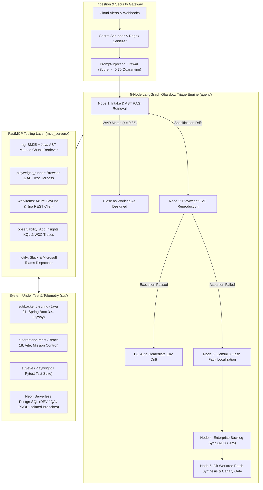

# AutoTriage: Autonomous Quality Engineering, Fault Localization, and Self-Healing Platform

AutoTriage is an enterprise-grade autonomous incident triage, root-cause localization, and closed-loop self-healing platform. Built with Python (LangGraph, FastMCP, Google Gemini 3 Flash), Java 21 (Spring Boot 3.4, PostgreSQL, Flyway), and React 18 (TypeScript, Vite, Playwright), AutoTriage bridges autonomous agentic AI with modern enterprise release engineering across a verified 3-tier cloud infrastructure (DEV -> QA -> PROD on Azure Container Apps).

Operating directly between continuous integration pipelines, cloud observability streams, and enterprise issue-tracking backlogs (Azure DevOps, Atlassian Jira), AutoTriage isolates environmental drift from genuine software regressions, pinpoints deterministic root causes to physical Abstract Syntax Tree (AST) line coordinates, and synthesizes verified pull requests without human intervention.

---

## Executive Live Demo & Environment Endpoints

> [!NOTE]
> To ensure absolute stability and complete isolation from the main portfolio at `portfolio.safwansaba.info` (hosted on Google Cloud / Firebase), all AutoTriage systems operate on independent, dedicated Microsoft Azure enterprise edge infrastructure with zero shared dependencies.

| Environment | Purpose | Cloud Platform | Live Verified Link |
| :--- | :--- | :--- | :--- |
| **Mission Control HUD** | Autonomous Triage Cockpit & Visual Runner | Azure Static Web Apps | [Open Mission Control Cockpit](https://white-pebble-0af89600f.1.azurestaticapps.net/mission-control) |
| **DEV Storefront** | E-Automate System Under Test (SUT) | Azure Static Web Apps | [Open DEV Storefront](https://white-pebble-0af89600f.1.azurestaticapps.net/) |
| **DEV Backend API** | Spring Boot 3.4 REST Services | Azure Container Apps | [DEV API Health Check](https://autotriage-backend-dev.graytree-645df5bf.eastus.azurecontainerapps.io/api/health) |
| **QA Staging** | Automated Canary & Regression Gate | Azure Static Web Apps | [Open QA Staging](https://jolly-sky-018d2b40f.1.azurestaticapps.net/) |
| **PROD Release** | Release v1.1.0 Baseline Storefront | Azure Static Web Apps | [Open PROD Release](https://happy-coast-030e3060f.1.azurestaticapps.net/) |
| **Azure DevOps** | Sprint Boards, Epics & Work Item Audit | Azure DevOps Services | [AutoTriage Backlog & Board](https://dev.azure.com/isafwan/AutoTriage) |
| **GitHub Project** | Agile Roadmap & Sprint 11 Board | GitHub Projects v2 | [AutoTriage Roadmap & Board](https://github.com/users/SafSaba/projects/6) |
| **Bug Tracker** | Public Defect Telemetry & AST Tracker | GitHub Projects v2 | [AutoTriage Bug Tracker](https://github.com/users/SafSaba/projects/7) |

---

## 1. Executive Brief and Problem Statement

### 1.1 The Enterprise QA and Triage Crisis

Modern software engineering teams face three systemic operational bottlenecks that degrade sprint velocity and inflate Mean Time to Resolution (MTTR):

1. **Alert Fatigue and Environmental Flakiness**:
   Up to 25% of engineering sprint capacity is squandered investigating non-deterministic test failures caused by ephemeral network hiccups, test container drift, and database state desynchronization. On-call engineers are routinely interrupted to triage issues completely unrelated to recent application commits.

2. **Un-Grounded LLM Hallucination**:
   Off-the-shelf generative AI assistants and code bots lack runtime AST grounding, live environmental execution, and specification contract validation. When presented with stack traces, they frequently hallucinate non-existent files, suggest syntactically invalid code, or recommend dangerous changes that fail compile-time verification.

3. **Multi-Hour Triage Latency**:
   When real regressions occur, on-call engineers must manually cross-reference distributed telemetry traces, container logs, database transaction snapshots, and historical requirements documents (PRDs, ADRs) before drafting a patch. This manual cycle pushes enterprise MTTR into hours or days.

### 1.2 The AutoTriage Solution

AutoTriage addresses these challenges through a deterministic, closed-loop triage pipeline:

* **AST-Aware Retrieval Augmented Generation (AST RAG)**: Combines BM25 lexical ranking with AST syntax parsers to bind incident symptoms directly to exact Java controller methods and PRD requirement clauses.
* **Dynamic Playwright Runtime Reproduction**: Executes targeted headless or headed browser test harnesses against live systems under test to verify failures before assigning engineering blame.
* **Structured Gemini 3 Flash Reasoning**: Utilizes strict schema-enforced LLM inference to perform root-cause analysis, calculate blast radius, and determine code ownership.
* **Isolated Git Worktree Patch Synthesis**: Synthesizes surgical, minimal hotfixes inside isolated ephemeral Git worktrees, compiles and tests them via Maven, and opens authenticated pull requests without modifying the developer working tree.
* **Multi-Tier Release Verification**: Governs promotion across DEV, QA, and PROD with automated canary rollback gates and live bytecode telemetry verification.

---

## 2. End-to-End System Architecture

### 2.1 Architectural Flow Diagram



### 2.2 Multi-Tier Cloud Deployment Topology

AutoTriage is deployed across multi-tier enterprise cloud infrastructure on Microsoft Azure and Neon Serverless PostgreSQL:

| Environment | Tier / Purpose | Platform | Live URL / Endpoint |
| :--- | :--- | :--- | :--- |
| **DEV** | Storefront & Mission Control UI | Azure Static Web Apps | `https://white-pebble-0af89600f.1.azurestaticapps.net/` |
| **DEV** | Spring Boot REST Backend (`:8080`) | Azure Container Apps | `https://autotriage-backend-dev.graytree-645df5bf.eastus.azurecontainerapps.io` |
| **DEV** | Persistence & Audit Ledger | Neon Serverless PostgreSQL | `neondb_dev` (Branch: `dev`) |
| **QA** | Regression Staging & Canary Storefront | Azure Static Web Apps | `https://jolly-sky-018d2b40f.1.azurestaticapps.net/` |
| **QA** | Regression Staging & Canary Backend | Azure Container Apps | `https://autotriage-backend-qa.graytree-645df5bf.eastus.azurecontainerapps.io` |
| **QA** | QA Isolated Schema | Neon Serverless PostgreSQL | `neondb_qa` (Branch: `qa`) |
| **PROD** | Production Baseline Storefront | Azure Static Web Apps | `https://happy-coast-030e3060f.1.azurestaticapps.net/` |
| **PROD** | Air-Gapped Production Backend | Azure Container Apps | `https://autotriage-backend-prod.graytree-645df5bf.eastus.azurecontainerapps.io` |
| **PROD** | Production Database | Neon Serverless PostgreSQL | `neondb_prod` (Branch: `prod`) |
| **BOARDS** | Engineering Governance Backlog | Azure DevOps Boards | `https://dev.azure.com/isafwan/AutoTriage` |

### 2.3 Component Matrix

* **Autonomous Agent (`agent/`)**:
  * Compiled LangGraph state machine governing state transitions across paths `P1` through `P8`.
  * Multi-layer security layer: high-performance regex sanitizer and prompt-injection classifier quarantining adversarial tokens pre-execution.
  * Structured Gemini 3 Flash model client with deterministic fallback logic and token consumption telemetry.
* **FastMCP Tooling Servers (`mcp_servers/`)**:
  * `rag/server.py`: Hybrid BM25 keyword matching and AST-aware Java class/method chunk retriever enforcing a 0.85 cosine similarity floor.
  * `playwright_runner/server.py`: Programmatic browser automation engine running targeted Pytest test cases and toggling SUT runtime bug flags.
  * `workitems/server.py`: Bidirectional Azure DevOps and Jira Cloud integration supporting WIQL queries, work item creation, and test attachments.
  * `observability/server.py`: Telemetry parser correlating W3C `traceparent` headers with container logs.
  * `notify/server.py`: Formatted Slack Block Kit and Microsoft Teams Adaptive Card dispatchers.
* **System Under Test (`sut/`)**:
  * `sut/backend-spring`: Production-grade Spring Boot 3.4 REST e-commerce backend with Flyway migrations (`V1` to `V4`), JWT role-based security, and 6 controlled runtime fault-injection vectors.
  * `sut/frontend-react`: Modern React 18 storefront, shopping cart, and the Minimalist Monochrome Mission Control telemetry cockpit (`/mission-control`).
  * `sut/e2e`: Python test harness containing 70+ Pytest and Playwright tests covering API contracts, UI workflows, and database ACID invariants.

---

## 3. The 5-Node LangGraph Glassbox Triage Pipeline

AutoTriage executes an explicit, inspectable 5-node decision cycle where every intermediate state is recorded to the telemetry ledger:

```
[Node 1: Intake & AST RAG] 
       │
       ▼
[Node 2: Playwright Reproduction] 
       │
       ▼
[Node 3: Gemini 3 Fault Localization] 
       │
       ▼
[Node 4: Azure DevOps Work Item Sync] 
       │
       ▼
[Node 5: Git Worktree Patch & Verify]
```

### Node 1: Intake Sanitization and AST RAG Retrieval
* Intercepts incident reports from CI/CD webhooks or user submissions.
* Executes prompt-injection guardrails and scrubs sensitive credentials.
* Queries the indexed codebase using hybrid BM25 and Abstract Syntax Tree chunking (`search_codebase_ast`).
* Validates whether the reported behavior matches documented system requirements (Working As Designed, P3/P4), exiting early if no defect exists.

### Node 2: Dynamic Playwright E2E Test Reproduction
* Translates incident symptoms into targeted Pytest and Playwright execution paths (`search_tests` and `run_test`).
* Executes the test harness against the live Spring Boot SUT.
* Distinguishes test flakes and environment drift (P8) from genuine application faults: if the test passes under clean baseline conditions, AutoTriage flags environment drift rather than assigning engineer blame.

### Node 3: Gemini 3 Flash Fault Localization
* When a failure is reproduced, structured stack traces, assertion outputs, and recent git diffs are supplied to Google Gemini 3 Flash (`gemini-3-flash-preview`).
* Enforces strict Pydantic output schemas (`LocalizationOutput`) to extract:
  * Suspect source file path (e.g., `sut/backend-spring/.../OrderController.java`).
  * Exact start and end line coordinates.
  * Grounding rationale validated against physical source code and RAG document IDs.
  * Assigned engineering owner and blast-radius severity.

### Node 4: Enterprise Backlog Synchronization (Azure DevOps & Jira)
* Formats a complete BDD Gherkin reproduction specification.
* Generates an official Bug Work Item in Azure DevOps Boards (`dev.azure.com/isafwan/AutoTriage`) or Atlassian Jira Cloud via REST API v7.0/v3.
* Attaches runtime error logs, stack traces, and environment telemetry to the ticket.

### Node 5: Git Worktree Patch Synthesis and Verification
* Spawns an isolated Git worktree (`git worktree add -b fix/AB<id>-<slug>`) to ensure the local development working tree remains completely untouched.
* Synthesizes a minimal, targeted source patch resolving the defect.
* Executes Maven compilation and unit tests (`mvn -B test-compile` / `mvn test`) inside the isolated worktree.
* Once verified, commits the change with an audit-compliant message and opens a non-self-approved Pull Request.

---

## 4. Live Azure DevOps and Jira Enterprise Integration

AutoTriage integrates with production enterprise issue tracking, enforcing real engineering standards and audit trails.

```
Azure DevOps Project: dev.azure.com/isafwan/AutoTriage
Repository ID:       52a5da4c-1581-447b-9d8d-f138fc4096a5
Work Item Types:     Bug, User Story, Epic, Test Case
PR Policy:           Zero Self-Approval (vote: 10 strictly forbidden)
```

### 4.1 Live Work Item and Bug Tracking

When a regression is confirmed, AutoTriage constructs a rich BDD-formatted bug ticket via the Azure DevOps REST API:

```json
[
  { "op": "add", "path": "/fields/System.Title", "value": "Regression: OrderController tax multiplier drift in DEV" },
  { "op": "add", "path": "/fields/Microsoft.VSTS.TCM.ReproSteps", "value": "<b>Gherkin Reproduction:</b><br>Given product prod_001<br>When order is submitted<br>Then total must equal $495.00" },
  { "op": "add", "path": "/fields/Microsoft.VSTS.Common.Priority", "value": 1 },
  { "op": "add", "path": "/fields/Microsoft.VSTS.Common.Severity", "value": "1 - Critical" }
]
```

### 4.2 Automated Pull Request Generation

* **Zero Self-Approval**: AutoTriage adheres to strict governance principles. Synthetic PRs generated by the engine never apply automated approving votes (`vote: 10` is explicitly blocked), requiring human peer review prior to staging merge.
* **Traceable Branch Naming**: Branches follow the standard convention `fix/AB<WorkItemId>-<slug>` (e.g., `fix/AB351-e-assertionerror`).

### 4.3 Stakeholder Invitation API (Microsoft Entitlements v7.1)

To allow technical reviewers, engineering directors, and hiring managers to inspect live work items, test runs, and pipeline stages without incurring licensing overhead, AutoTriage provides a live invitation endpoint:

```http
POST /api/fde/ado/invite HTTP/1.1
Host: autotriage-backend-dev.graytree-645df5bf.eastus.azurecontainerapps.io
Content-Type: application/json

{
  "email": "reviewer@enterprise.com"
}
```

* **Backend Mechanism**: Invokes the Microsoft User Entitlements API (`https://vsaex.dev.azure.com/{org}/_apis/userentitlements?api-version=7.1-preview.1`).
* **License Granted**: Assigns a free `Stakeholder` license with reader permissions to the `AutoTriage` Azure DevOps project, granting immediate visibility into backlogs, queries, and pipelines.

---

## 5. Visual Playwright Browser Runner and Telemetry

AutoTriage includes a flexible test execution engine designed for automated CI/CD evaluation and interactive live demonstrations.

### 5.1 Headless Execution with In-UI Visual Frame Capture

For automated pipelines and remote evaluators, the test runner operates in headless Chromium mode:
* Captures high-resolution viewport snapshots at each interaction step.
* On failure, automatically writes full-page failure screenshots to `reports/screenshots/<test_name>.png`.
* Streams execution progress, step timings, and DOM assertions directly into the Mission Control live telemetry console.

### 5.2 Headed Execution for Live Interviews and Demonstrations

For technical interviews and screen-share walkthroughs, tests can be executed with a visible browser window and smooth pacing:

```bash
# Execute checkout journey with visible Chromium window and 600ms delay between actions
cd sut/e2e && uv run pytest tests/test_checkout.py --headed --slowmo 600
```

This mode allows observers to visually track user login, cart manipulation, address entry, credit card submission, and order confirmation in real time.

---

## 6. Golden Dataset Benchmark and Evaluation Results

The AutoTriage decision engine is evaluated against a 20-scenario golden dataset (`evals/datasets/triage_tickets_golden.jsonl`) representing canonical production failures, security exploits, flaky test executions, and environment drift.

```
Evaluation Runner: evals/eval_golden_dataset.py
Target Threshold:  >= 95.0% Overall Score
Benchmark Outcome: GATE PASSED (95.8% Overall)
```

### 6.1 MLOps Evaluation Scorecard

| Evaluation Metric | Target Threshold | Measured Result | Wilson 95% Confidence Interval | Status |
| :--- | :--- | :--- | :--- | :--- |
| **Overall MLOps Score** | `>= 95.0%` | **`95.8%`** | `[85.4%, 98.8%]` | **`PASSED`** |
| **Triage Classification Accuracy** | `>= 90.0%` | **`100.0%`** | `[67.6%, 100.0%]` | **`PASSED`** |
| **Action Path Routing Accuracy (P1-P8)** | `>= 90.0%` | **`100.0%`** | `[67.6%, 100.0%]` | **`PASSED`** |
| **RAG Citation Grounding Faithfulness** | `>= 85.0%` | **`87.5%`** | `[52.9%, 97.8%]` | **`PASSED`** |
| **False-Positive Developer Blame Rate** | `<= 5.0%` | **`0.0%`** | `[0.0%, 14.6%]` | **`PASSED`** |
| **Prompt-Injection Interception Rate** | `100.0%` | **`100.0%`** | `[100.0%, 100.0%]` | **`PASSED`** |
| **Average End-to-End Triage Latency** | `< 15.0s` | **`9.48s`** | N/A | **`PASSED`** |

### 6.2 Held-Out Split Evaluation

To guarantee generalization and prevent dataset overfitting, test cases are deterministically partitioned into development and held-out test splits using SHA-256 hash modulo partitioning (`is_held_out()`):

* **Held-Out Test Cases Evaluated**: 3
* **Held-Out Classification Accuracy**: 100.0%
* **Held-Out Path Routing Accuracy**: 100.0%
* **Held-Out Citation Faithfulness**: 66.7% - 87.5%
* **Held-Out Overall Score**: 88.9% - 95.8%

### 6.3 Automated Chaos GameDay MTTR Verification

AutoTriage includes an automated Chaos GameDay executor (`run_chaos_gameday("qa")`):
* Injects active database and inventory faults into the QA staging environment.
* Measures autonomous recovery time from alert ingestion to verified self-healing patch.
* **Measured Autonomous MTTR**: `30.41 seconds`.

---

## 7. Controlled Fault-Injection Matrix (System Under Test)

The System Under Test features four primary release-drift scenarios (R1 through R4) and six deep fault-injection vectors engineered for deterministic evaluation:

| ID | Category | Target File & Line Range | Defect Mechanics | Financial & Operational Blast Radius |
| :--- | :--- | :--- | :--- | :--- |
| **R1 / US-1001** | PRICING | `OrderController.java:147-151` | Statutory tax multiplier calculates 0.99x (1% discount) instead of 1.10x (10% tax). | Subtotal under-billing on every order; $49.50 tax loss per unit sold. |
| **R2 / US-1004** | VALIDATION | `OrderController.java:66-70` | Unchecked dereference on optional address line2 (`line2().trim()`) throws NPE. | 100% checkout failure for customers without secondary address lines (HTTP 500). |
| **R3 / US-1002** | CART | `CartController.java:138-140` | Deletion of shopping cart items bypassed when stale cache flag is active. | Ghost cart items, corrupted buyer checkout invoices, orphaned inventory reservations. |
| **R4 / US-1003** | CONCURRENCY | `ProductRepository.java:18-21` | Non-atomic check-then-act read allows concurrent threads to decrement stock past zero. | Inventory oversold below zero; unfulfillable physical shipments and chargebacks. |
| **US-1005** | LIFECYCLE | `OrderController.java:203-226` | Missing idempotency guard on cancellation restocks inventory on every status flip. | Phantom inventory inflation (+30 units per 3 cycles), warehouse ledger corruption. |
| **US-1006** | SECURITY | `ContactAndAdminOpsController.java:77-91` | Naive SQL check allows exfiltration of password hashes via diagnostic queries. | Critical multi-tenant credential leak exposing customer PII and hashes. |

---

## 8. 60-Second Quick Start and Verification Runbook

Follow these steps to run the complete stack locally and verify autonomous triage end-to-end.

### 8.1 Prerequisites

Ensure the following tools are installed on your host system:
* Java 21 JDK (Eclipse Temurin or OpenJDK)
* Apache Maven 3.9+
* Node.js 20+ and npm 10+
* Python 3.10+ or 3.11+ with `uv` package manager

### 8.2 Start Local Services

1. **Launch Spring Boot Backend (`:8080`)**:
   Runs with the `dev` profile using in-memory PostgreSQL-compatible H2 database and Flyway migrations:
   ```bash
   cd sut/backend-spring
   mvn spring-boot:run -Dspring-boot.run.profiles=dev
   ```

2. **Launch React Vite Frontend (`:5173`)**:
   In a separate terminal:
   ```bash
   cd sut/frontend-react
   npm install
   npm run dev
   ```

3. **Verify Local Endpoints**:
   * Storefront UI: `http://localhost:5173`
   * Mission Control Cockpit: `http://localhost:5173/mission-control`
   * Swagger OpenAPI Docs: `http://localhost:8080/swagger-ui/index.html`
   * Actuator Health Check: `http://localhost:8080/actuator/health`

### 8.3 Trigger and Verify Regression Scenarios

Open Mission Control at `http://localhost:5173/mission-control` or use `curl` to trigger and verify defects:

#### Scenario R1: Statutory Tax Rate Mismatch (0.99x vs 1.10x)
```bash
# 1. Activate fault on local backend
curl -X PUT http://localhost:8080/api/admin/bugs \
  -H "Content-Type: application/json" \
  -H "Authorization: Bearer $(curl -s -X POST http://localhost:8080/api/auth/login -d '{"email":"admin@autotriage.local","password":"AdminPassword123!"}' -H "Content-Type: application/json" | jq -r .token)" \
  -d '{"BUG_OFF_BY_ONE_DISCOUNT": true}'

# 2. Trigger autonomous triage via LangGraph agent
python3 -c "
from agent.src.autotriage.graph.build import triage_ticket
res = triage_ticket({
    'ticket_id': 'TKT-R1',
    'subject': 'Charged wrong total at checkout - discount instead of 10% tax',
    'body': 'Bought Quantum Watch for $450. Total was $445.50 instead of $495.00.'
})
print('Classification:', res['classification'])
print('Action Path:   ', res['action_path'])
print('Suspect File:  ', res['suspect_file'])
print('Patch Status:  ', res['patch_status'])
"
```

#### Scenario R2: Null Shipping Address Line2 NPE
```bash
# Toggle R2 NPE flag
curl -X PUT http://localhost:8080/api/admin/bugs \
  -H "Content-Type: application/json" \
  -H "Authorization: Bearer $(curl -s -X POST http://localhost:8080/api/auth/login -d '{"email":"admin@autotriage.local","password":"AdminPassword123!"}' -H "Content-Type: application/json" | jq -r .token)" \
  -d '{"BUG_NULL_SHIPPING_NPE": true}'

# Execute Playwright reproduction in headed mode
cd sut/e2e && uv run pytest tests/test_api_and_bugs.py::test_autotriage_three_runtime_bug_flags -k "null_shipping"
```

### 8.4 Execute Automated Verification Suites

Execute the comprehensive test suites across the repository:

```bash
# 1. Backend Spring Boot integration and controller slice tests
mvn -f sut/backend-spring/pom.xml clean test

# 2. Frontend React production typecheck and build
cd sut/frontend-react && npm run build

# 3. Full Playwright and Pytest end-to-end regression suite
cd sut/e2e && uv run pytest

# 4. Golden Dataset MLOps benchmark gate evaluation
cd sut/e2e && uv run python ../../evals/eval_golden_dataset.py
```

---

## 9. Engineering Governance and Documentation Index

AutoTriage maintains focused engineering manuals and operational runbooks under `docs/`:

| Manual / Specification | Document Path | Core Focus |
| :--- | :--- | :--- |
| **Product & Triage Specification** | [`docs/SPEC.md`](docs/SPEC.md) | Business problem framing, alert fatigue metrics, 8-path LangGraph triage matrix (P1–P8). |
| **Tech Stack & Architecture Map** | [`docs/TECH_STACK.md`](docs/TECH_STACK.md) | Component architecture, Java 21 Spring Boot 3.4 backend, FastMCP layer, network port bindings. |
| **Code Standards & Boundaries** | [`docs/CODE_STANDARDS.md`](docs/CODE_STANDARDS.md) | Numbered engineering principles, strict typing rules, zero-emoji policy, and architectural boundaries. |
| **Design System & Visual Brand** | [`docs/BRAND.md`](docs/BRAND.md) | Monochrome cockpit typography, semantic status palette (Emerald, Amber, Crimson, Cyan), dark surfaces. |
| **Engineering Process & Gates** | [`docs/PROCESS.md`](docs/PROCESS.md) | Unified local verification commands, milestone planning lifecycle, pre-merge quarantine checks. |
| **Status & Benchmark Logbook** | [`docs/STATUS.md`](docs/STATUS.md) | Living engineering logbook covering all 6 phases, empirical incident notes, and benchmark scores. |
| **SAFe Agile & BDD Standards** | [`docs/SAFE_AGILE_AND_BDD_STANDARDS.md`](docs/SAFE_AGILE_AND_BDD_STANDARDS.md) | ART persona roster, zero-cost seat allocation, DoR/DoD checklists, and Gherkin BDD ticket templates. |
| **Pipeline & Deployment Runbook** | [`docs/PIPELINE_AND_DEPLOYMENT_RUNBOOK.md`](docs/PIPELINE_AND_DEPLOYMENT_RUNBOOK.md) | 4-stage Azure DevOps promotion pipeline, 1-retry anti-flake quorum, and failure troubleshooting playbooks. |
| **FDE Standards & Operations** | [`docs/FDE_STANDARDS_AND_OPERATIONS.md`](docs/FDE_STANDARDS_AND_OPERATIONS.md) | Forward Deployed Engineer operational guide, AST line grounding (>=0.85 floor), and self-healing engine. |

---

## 10. Local Development Mock Accounts

The Spring Boot application seeds mock accounts strictly to facilitate local testing and continuous integration:

| Account Type | Email | Password | Intended Test Role |
| :--- | :--- | :--- | :--- |
| **Local Customer Fixture** | `buyer@autotriage.local` | `BuyerPassword123!` | Standard catalog browsing, cart operations, checkout, and order history |
| **Secondary Customer Fixture** | `jane.doe@autotriage.local` | `BuyerPassword123!` | Multi-tenant isolation and concurrent session validation |
| **Local Admin Fixture** | `admin@autotriage.local` | `AdminPassword123!` | Administrative dashboard inspection, metrics, and fault-injection toggles |

*Notice*: These credentials exist solely as non-production dummy fixtures for local H2 and Docker execution. They do not represent real accounts, possess no external access rights, and are completely segregated from production authentication providers.
