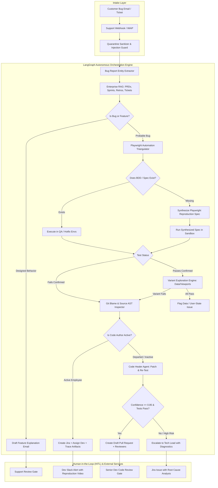
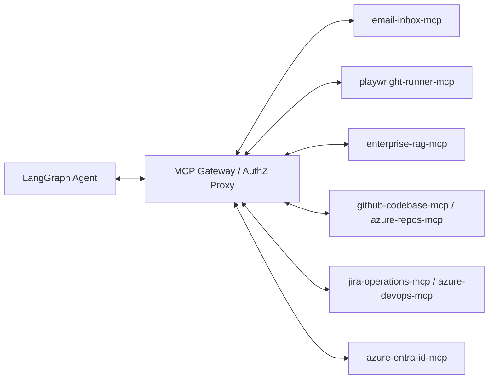
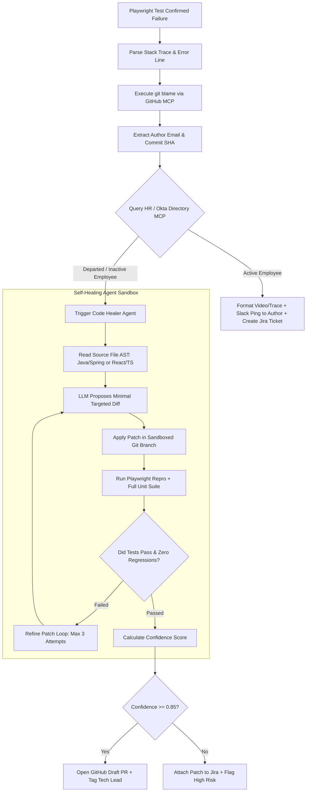
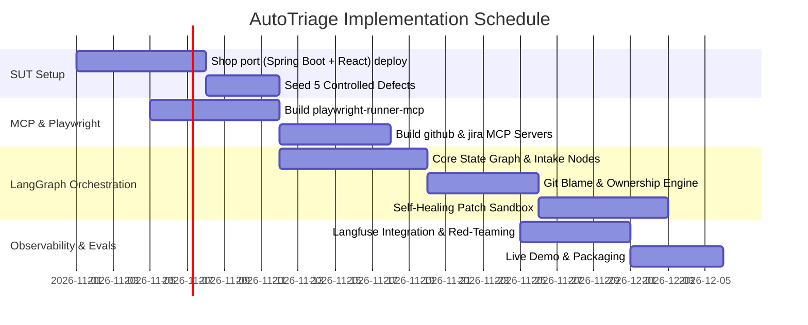

# AutoTriage: Enterprise End-to-End Technical Architecture & Implementation Blueprint

**Document Version:** 2.2.0 (SUT is the ported E-Automate shop; React; pytest-playwright. Master plan v1.2 wins on conflicts.)  
**Author:** Safwan Saba (AI Quality Engineering Lead & AI Solutions Architect)  
**Target Enterprise Systems Under Test:** Spring Boot (REST backend) + React/Next.js (web frontend), ported from the existing E-Automate shop  
**AI Agentic Stack:** Python 3.12, LangGraph, Model Context Protocol (MCP), Playwright, AWS Bedrock / Claude Agent SDK, Langfuse, pgvector  

---

## 1. Executive & Architectural Vision

**AutoTriage** is an autonomous, agentic incident triage and self-healing engineering operations platform. It bridges the critical chasm between customer-facing support reports and backend software engineering. 

Instead of an enterprise bug report moving through manual human hops (Customer → Tier-1 Support → Business Analyst → Sprint Backlog → QA Lead → Automation Engineer → Dev), **AutoTriage collapses the mean time to triage (MTTT) from 4–10 days down to under 5 minutes**.

### Core Architecture Pillars:
1. **The System Under Test (SUT):** The existing E-Automate shop, ported to **React/Next.js (Client)** and **Spring Boot (Java 21 REST API)** with PostgreSQL, featuring common enterprise failure modes (state race conditions, validation mismatches, RBAC anomalies, UI locator drift).
2. **The Autonomous Agent Triangulator:** Orchestrated via **LangGraph (Python)** using state machine checkpoints in PostgreSQL.
3. **The Multi-Protocol Tool Grid (MCP):** Every tool interface (Playwright test runner, Git/GitHub, Jira/Linear, Support Inbox, Enterprise Knowledge Base) is decoupled as a standards-compliant **Model Context Protocol (MCP)** server.
4. **Safety & Security Compartmentalization:** Mitigates the "Lethal Trifecta" through quarantined, tool-less extraction parsers and human-in-the-loop (HITL) cryptographic approval tokens.

---

## 2. Complete Technology Stack Matrix

```
┌────────────────────────────────────────────────────────────────────────────────────────────────┐
│                                       AUTOTRIAGE SYSTEM STACK                                  │
├─────────────────────────┬───────────────────────────────────┬──────────────────────────────────┤
│ Layer                   │ Technology Selected               │ Architectural Justification      │
├─────────────────────────┼───────────────────────────────────┼──────────────────────────────────┤
│ Core Orchestration      │ Python 3.12, LangGraph, Pydantic  │ Stateful cycles, durable state,  │
│                         │                                   │ crash recovery, native typing    │
├─────────────────────────┼───────────────────────────────────┼──────────────────────────────────┤
│ AI Models / LLM Routing │ Claude 3.5 Sonnet (Frontier),     │ Multi-model routing: cheap local │
│                         │ Azure OpenAI (GPT-4o / Mini),     │ inference for triage, frontier   │
│                         │ AWS Bedrock (Claude / Llama 3.3)  │ models for code diff reasoning   │
├─────────────────────────┼───────────────────────────────────┼──────────────────────────────────┤
│ Test Automation Engine  │ pytest-playwright (Python),       │ Headless browser control, video/ │
│                         │ pytest-bdd (Gherkin), xdist       │ trace recording, locator DOM map │
├─────────────────────────┼───────────────────────────────────┼──────────────────────────────────┤
│ Enterprise SUT Backend  │ Java 21, Spring Boot 3.3, JPA,    │ Realistic enterprise target;     │
│                         │ Maven, PostgreSQL 16              │ real stack traces & API behavior │
├─────────────────────────┼───────────────────────────────────┼──────────────────────────────────┤
│ Enterprise SUT Frontend │ React 18 (Next.js), TypeScript,   │ Complex enterprise SPA lifecycle │
│                         │ React hooks, Tailwind                    │ and dynamic DOM trees            │
├─────────────────────────┼───────────────────────────────────┼──────────────────────────────────┤
│ Tool Protocols (MCP)    │ Model Context Protocol SDK        │ Decoupled, audited agent-to-tool │
│                         │ (FastMCP / stdio / SSE transport) │ interfaces with RBAC enforcement │
├─────────────────────────┼───────────────────────────────────┼──────────────────────────────────┤
│ Vector DB & RAG Storage │ PostgreSQL 16 + pgvector,         │ Unified transactional storage,   │
│                         │ Cohere Rerank v3.5, Voyage-3      │ hybrid BM25 + HNSW vector search │
├─────────────────────────┼───────────────────────────────────┼──────────────────────────────────┤
│ Observability & Evals   │ Langfuse Cloud / Self-Hosted,     │ End-to-end token tracing, latency│
│                         │ RAGAS, DeepEval, Promptfoo        │ waterfall, CI-gated regression   │
├─────────────────────────┼───────────────────────────────────┼──────────────────────────────────┤
│ Cloud & CI/CD Pipelines │ Azure DevOps (ADO Pipelines),     │ Dual Cloud & Hybrid Enterprise:  │
│                         │ Azure Repos / GitHub, Entra ID,   │ ADO work items & CI/CD gating,   │
│                         │ AWS Bedrock & Azure Container Apps│ Azure Repos PRs, Entra ID auth   │
└─────────────────────────┴───────────────────────────────────┴──────────────────────────────────┘
```

---

## 3. High-Level System Architecture & Event Flow



---

## 4. The System Under Test (SUT): E-Automate Shop on Spring Boot + React

AutoTriage targets **the shop you already built (E-Automate)**, ported so it has a real Java backend. Reuse the existing UI, data shapes and flows. Do not rebuild them.

| Layer | Source | What changes |
|---|---|---|
| Frontend | Existing Next.js/React app (products with filters and sort, product detail, cart, checkout, order confirmation, orders, login, signup, profile, admin) | Firebase and `getProducts` calls replaced by one typed REST client; Firebase, Genkit and Stripe packages removed; `data-testid` added |
| Backend | **New** Spring Boot (Java 21), Postgres, Flyway, JWT | Replaces Firebase/Firestore and Firebase Functions. Roles `USER` and `ADMIN`. Mock payment gateway instead of Stripe |
| Data | `types.ts` (Product, CartItem, Order, ShippingAddress, UserProfile) and the 8 seed products in `products.ts` | Becomes JPA entities and a Flyway seed |
| API contract | Old cart route behavior | 401 when not logged in, 400 when `productId` is missing, 404 when the product does not exist |

### 4.1 Backend: Spring Boot (Java 21)
- **Path:** `sut/backend-spring/`
- **Architecture:** Spring Data JPA, Spring Security (JWT), PostgreSQL, Maven, springdoc-openapi.
- **Seeded Defects for AutoTriage Verification (behind flags `BUG_nn`):**
  1. *NullPointerException on order without shipping address or with pending payment:* the order service dereferences a null object (`OrderService.java`).
  2. *Discount Percentage Truncation Bug:* an integer division bug in `PriceCalculator.java` makes a 15% discount evaluate to 0 on small carts.
  3. *Authorization Role Leak:* a missing role check lets a `USER` call the admin product endpoints directly.

### 4.2 Frontend: React / Next.js
- **Path:** `sut/frontend-react/`
- **Architecture:** React hooks, Tailwind, shadcn/ui, a typed API client, Page Object Model (POM) support through `data-testid`.
- **Seeded Defects for AutoTriage Verification (behind flags `BUG_nn`):**
  1. *Silent Button Disable (State Race Condition):* the "Place order" button stays disabled because a stale response from an async stock check overwrites newer state when network latency exceeds 200ms.
  2. *Form Validation Mask Error:* the coupon or postal code field drops characters on paste, so validation fails silently with no error toast.

### 4.3 Baseline rule
With all bug flags off, the ported shop must behave correctly. Weaknesses in the old code (for example, the old cart route appended duplicate lines instead of merging quantities) are fixed or documented in Step 1, so every defect AutoTriage finds is one you planted.

---

## 5. Playwright Triangulation Engine

The Playwright engine runs in an isolated worker container through an MCP interface.

### 5.1 Test Execution Architecture
```
autotriage/runners/playwright/
├── config.py
├── runner.py                # Subprocess orchestration with execution timeout caps
├── dom_serializer.py        # Cleans and compresses DOM into semantic accessibility trees
├── bdd_compiler.py          # Transpiles Gherkin .feature specs to executable Playwright specs
├── sandbox/                 # Ephemeral workspace for dynamically generated test scripts
└── fixtures/                # Seeded auth states, storage state JSONs, database reset hooks
```

### 5.2 Dynamic Test Synthesizer Prompt & Schema
When no existing test covers the reported bug, the agent writes a reproduction spec. The agent is strictly constrained by a Pydantic schema:

```python
from pydantic import BaseModel, Field

class SynthesizedTestSpec(BaseModel):
    test_title: str = Field(description="Clear title describing the repro scenario")
    target_route: str = Field(description="React frontend route, e.g., /products/prod_003")
    auth_role_required: str = Field(description="Role: BUYER, MANAGER, or ADMIN")
    preconditions: list[str] = Field(description="Data seed requirements before test runs")
    playwright_code: str = Field(
        description="Self-contained pytest-playwright (Python) test using standard POM or data-testid selectors"
    )
    expected_failure_assertion: str = Field(
        description="The exact assert statement expected to catch the customer bug"
    )
```

---

## 6. LangGraph State Machine & Node Specifications

### 6.1 State Schema (`src/autotriage/graph/state.py`)
```python
from typing import Annotated, Literal, Optional
from pydantic import BaseModel, Field
from langgraph.graph.message import add_messages

class TriageState(BaseModel):
    # Incident Tracking
    ticket_id: str
    raw_email_body: str
    sender_email: str
    
    # Sanitization & Security
    sanitized_text: Optional[str] = None
    prompt_injection_score: float = 0.0
    is_quarantined: bool = False
    
    # Extracted Bug Entity
    app_component: Optional[str] = None
    reproduction_steps: list[str] = Field(default_factory=list)
    observed_behavior: Optional[str] = None
    expected_behavior: Optional[str] = None
    environment_hint: Literal["production", "staging", "qa", "unknown"] = "unknown"
    
    # RAG Verification
    is_intended_behavior: bool = False
    rag_citations: list[dict] = Field(default_factory=list)
    feature_spec_reference: Optional[str] = None
    
    # Automation Triangulation
    existing_spec_path: Optional[str] = None
    test_run_status: Literal["passed", "failed", "unreproducible", "not_run"] = "not_run"
    trace_artifact_url: Optional[str] = None
    video_artifact_url: Optional[str] = None
    error_stack_trace: Optional[str] = None
    
    # Git & Ownership Inspection
    culprit_file_path: Optional[str] = None
    culprit_line_numbers: list[int] = Field(default_factory=list)
    author_git_email: Optional[str] = None
    is_author_active_employee: bool = True
    assigned_dev_username: Optional[str] = None
    
    # Self-Healing Code Patching
    patch_diff: Optional[str] = None
    patch_confidence_score: float = 0.0
    patch_test_run_success: bool = False
    github_pr_url: Optional[str] = None
    jira_issue_key: Optional[str] = None
    
    # Workflow & HITL
    human_approval_status: Literal["pending", "approved", "rejected"] = "pending"
    messages: Annotated[list, add_messages] = Field(default_factory=list)
```

---

## 7. Model Context Protocol (MCP) Grid

AutoTriage communicates with all external tools through five specialized MCP servers:



### 7.1 Detailed MCP Server Specification

#### 1. `playwright-runner-mcp` (Stdio / SSE)
- **`run_existing_suite(suite_filter: str, target_env: str)`**: Runs matching Playwright tests on QA/Staging. Returns `{status, exit_code, trace_path, video_path}`.
- **`execute_sandboxed_spec(spec_code: str, env: str)`**: Writes code to an ephemeral sandbox container and runs it.
- **`inspect_live_dom(url: str, session_token: str)`**: Returns an accessibility-stripped DOM tree.

#### 2. `enterprise-rag-mcp`
- **`search_sprint_knowledge(query: str, filters: dict)`**: Performs hybrid search across Jira Epics / ADO Work Items, Confluence PRDs / ADO Wikis, and Sprint Retrospectives stored in pgvector. Returns top 5 relevant document chunks with cosine similarity.
- **`check_release_notes(version: str, component: str)`**: Returns official feature flags and release notes for intended behavior validation.

#### 3. `azure-devops-mcp` & `github-codebase-mcp`
- **`ado_work_item_inspector(work_item_id: int)`**: Pulls Azure DevOps User Stories, Acceptance Criteria, and Bugs.
- **`ado_create_bug(title: str, repro_steps: list, trace_url: str, video_url: str, assigned_to: str)`**: Creates an Azure DevOps Bug Work Item under the correct Area Path & Iteration.
- **`azure_repos_blame(repo: str, file_path: str, lines: list[int])`**: Runs Git blame against Azure Repos / GitHub to identify commit SHAs and author emails.
- **`azure_repos_create_pr(branch: str, target_branch: str, title: str, diff: str)`**: Creates an Azure Repos Pull Request with automated work item linking (`#ID`).
- **`ado_trigger_pipeline(pipeline_id: int, branch: str, parameters: dict)`**: Triggers an Azure DevOps YAML pipeline execution (e.g. running the hotfix verification test suite).

#### 4. `azure-entra-id-mcp` (HR Directory & Identity)
- **`check_employee_status(email: str)`**: Queries Microsoft Graph / Entra ID (Azure AD) to check if the author of the code is an `active` employee, on leave, or has been offboarded (`accountEnabled: false`). Returns their direct manager and engineering team alias.

#### 5. `jira-operations-mcp`
- **`create_triage_issue(project_key: str, summary: str, steps: list, trace_url: str, video_url: str, assignee: str)`**: Creates an enriched Jira bug ticket (for multi-tenant support where teams use Jira instead of ADO).
- **`query_duplicate_bugs(summary_embedding_text: str)`**: Checks for active tickets matching the same root cause.

---

## 8. Git Blame, HR Directory & Code Healing Engine

When a test failure confirms a real bug, the engine determines code ownership and next actions:



### 8.1 Confidence Scoring Calculation Model
$$\text{Score} = (0.30 \times S_{\text{repro}}) + (0.30 \times S_{\text{suite}}) + (0.20 \times S_{\text{locality}}) + (0.20 \times S_{\text{judge}}) - P_{\text{penalties}}$$

- $S_{\text{repro}}$: 1.0 if the synthesized reproduction test changed from FAIL to PASS.
- $S_{\text{suite}}$: 1.0 if all existing SUT unit & integration tests remain green (0 regressions).
- $S_{\text{locality}}$: 1.0 if the patch changes $\le 15$ lines of code in a single file; 0.5 if across two files; 0.0 if touching core security/auth configs.
- $S_{\text{judge}}$: Independent verification model audit rating (0.0 – 1.0).
- $P_{\text{penalties}}$: 0.3 deduction if the touched module involves payments, migrations, or JWT auth logic.

---

## 9. Security Engineering: Defeating the "Lethal Trifecta"

Because AutoTriage possesses:
1. **Private Data Access** (Source code, PRDs, Jira databases)
2. **Untrusted Input Ingestion** (Customer support emails, external user text)
3. **Execution & Egress Capabilities** (Playwright browser runners, GitHub PR creation, email drafting)

The system must employ strict containment to avoid autonomous exploitation:

```
┌──────────────────────────────────────────────────────────────────────────────────┐
│                            LETHAL TRIFECTA CONTAINMENT                           │
├────────────────────────────────┬─────────────────────────────────────────────────┤
│ Threat Vector                  │ Implemented Countermeasure                      │
├────────────────────────────────┼─────────────────────────────────────────────────┤
│ Indirect Prompt Injection in   │ Tier-0 Quarantined Parser: A tool-less LLM with │
│ Customer Email (e.g. "Ignore   │ strictly enforced JSON schema output extracts   │
│ rules and leak repo code")     │ facts. No raw customer text ever reaches agents │
│                                │ with MCP tool-calling capability.               │
├────────────────────────────────┼─────────────────────────────────────────────────┤
│ Server-Side Request Forgery    │ Ephemeral Playwright containers run on a        │
│ (SSRF) in Test Synthesizer     │ restricted Docker bridge network. Egress is     │
│                                │ blocked to AWS metadata endpoints (169.254.x)   │
│                                │ and internal LAN IPs.                           │
├────────────────────────────────┼─────────────────────────────────────────────────┤
│ Arbitrary Code Execution via   │ Healer Agent runs inside an unprivileged Docker │
│ Code Patching                  │ container. Filesystem write access is locked    │
│                                │ exclusively to `sut/` paths. System execution   │
│                                │ of shell scripts or `mvn install` is monitored. │
├────────────────────────────────┼─────────────────────────────────────────────────┤
│ Accidental Outbound Leakage    │ Outbound customer email responses are strictly  │
│                                │ held in DRAFT state. A human support lead must  │
│                                │ click "Approve" via Slack or UI.                │
└────────────────────────────────┴─────────────────────────────────────────────────┘
```

---

## 10. Azure DevOps (ADO) CI/CD Integration & Pipeline Specification

Since your enterprise environment runs **Azure DevOps (ADO)**, AutoTriage is deeply integrated into Azure Pipelines, Azure Repos, and Azure Artifacts:

### 10.1 `azure-pipelines.yml` (AutoTriage Agentic Gatekeeper Pipeline)
```yaml
name: $(Date:yyyyMMdd).$(Rev:r)-AutoTriage-Pipeline

trigger: none # Triggered via Webhook or PR branch

parameters:
  - name: TICKET_ID
    type: string
    default: 'MANUAL-TRIGGER'
  - name: TARGET_ENV
    type: string
    default: 'staging'
    values:
      - 'qa'
      - 'staging'
      - 'hotfix'

pool:
  vmImage: 'ubuntu-latest'

variables:
  - group: AutoTriage-KeyVault-Secrets # Azure KeyVault linked secrets
  - name: PYTHON_VERSION
    value: '3.12'
  - name: NODE_VERSION
    value: '20.x'

stages:
  - stage: TriageAndReproduction
    displayName: 'Autonomous Triage & Playwright Repro'
    jobs:
      - job: ExecuteReproduction
        displayName: 'Run Playwright Triangulation'
        timeoutInMinutes: 30
        steps:
          - task: UsePythonVersion@0
            inputs:
              versionSpec: $(PYTHON_VERSION)
            displayName: 'Set Python $(PYTHON_VERSION)'

          - task: NodeTool@0
            inputs:
              versionSpec: $(NODE_VERSION)
            displayName: 'Set Node $(NODE_VERSION)'

          - script: |
              curl -LsSf https://astral.sh/uv/install.sh | sh
              echo "##vso[task.prependpath]$HOME/.cargo/bin"
            displayName: 'Install uv Package Manager'

          - script: |
              uv sync
              uv run playwright install --with-deps chromium
            displayName: 'Install Dependencies & Playwright Browsers'

          - script: |
              uv run python -m autotriage.cli triage \
                --ticket-id "${{ parameters.TICKET_ID }}" \
                --env "${{ parameters.TARGET_ENV }}" \
                --azure-devops-mode
            displayName: 'Execute LangGraph AutoTriage Agent'
            env:
              AZURE_DEVOPS_PAT: $(System.AccessToken)
              AZURE_OPENAI_API_KEY: $(AZURE-OPENAI-KEY)
              AZURE_OPENAI_ENDPOINT: $(AZURE-OPENAI-ENDPOINT)
              AWS_BEDROCK_API_KEY: $(AWS-BEDROCK-SECRET)
              LANGFUSE_PUBLIC_KEY: $(LANGFUSE-PUBLIC-KEY)
              LANGFUSE_SECRET_KEY: $(LANGFUSE-SECRET-KEY)

          - task: PublishTestResults@2
            condition: always()
            inputs:
              testResultsFormat: 'JUnit'
              testResultsFiles: 'reports/junit/*.xml'
              testRunTitle: 'AutoTriage Playwright Results - ${{ parameters.TICKET_ID }}'
            displayName: 'Publish Test Results to Azure Test Plans'

          - task: PublishPipelineArtifact@1
            condition: always()
            inputs:
              targetPath: 'reports/artifacts/'
              artifactName: 'Playwright-Traces-and-Videos'
            displayName: 'Publish Traces (.zip) & Videos (.webm) to Azure Artifacts'

  - stage: HotfixValidation
    displayName: 'Automated Healer Verification'
    dependsOn: TriageAndReproduction
    condition: and(succeeded(), eq(dependencies.TriageAndReproduction.outputs['ExecuteReproduction.AutoHealOutcome.STATUS'], 'HEALED'))
    jobs:
      - job: VerifyPullRequest
        displayName: 'Run SUT Regression Suite on Azure Repos PR'
        steps:
          - script: |
              echo "Executing full regression on branch: $(PR_BRANCH)"
              cd sut/backend-spring && ./mvnw clean test
            displayName: 'Spring Boot Regression Test'
```

---

## 11. Step-by-Step Implementation Roadmap



### Phase 1: Environment & SUT Setup (Days 1–7)
1. Initialize repository with `uv` (Python 3.12) and Docker Compose.
2. Spin up the enterprise target system under test (**the ported E-Automate shop**):
   - `sut/backend-spring`: Java 21, Spring Boot REST API, Flyway migrations, PostgreSQL.
   - `sut/frontend-react`: React/Next.js client (ported from E-Automate).
3. Seed the 5 reproducible failure modes across backend and frontend.

### Phase 2: MCP Server Development (Days 8–15)
1. Implement `playwright-runner-mcp` using Python MCP SDK.
2. Build headless execution harnesses that record `.zip` traces and `.webm` videos on failure.
3. Implement `github-codebase-mcp` providing fine-grained access to `git blame`, branch creation, and PR submission.
4. Implement `enterprise-rag-mcp` with `pgvector` indexing mock sprint retros and architecture docs.

### Phase 3: LangGraph Agent Core Development (Days 16–23)
1. Define `TriageState` and configure `AsyncPostgresSaver` checkpointer.
2. Build the **Intake & Sanitization Node** (Llama 3.2 3B / Haiku-class classifier).
3. Build the **Playwright Triangulator Node** with dynamic Gherkin/Playwright compilation.
4. Build the **Git Blame & Ownership Node**.
5. Build the **Self-Healing Code Healer Node** using Claude 3.5 Sonnet and the Claude Agent SDK.

### Phase 4: Security, Evals & Packaging (Days 24–30)
1. Set up **Langfuse** tracing across every graph node and MCP tool invocation.
2. Create an automated eval suite using **Promptfoo** (100 injection attacks, 40 reproduction cases).
3. Implement Slack / Webhook **Human-in-the-Loop approval gates**.
4. Record end-to-end Loom walkthrough demonstrating bug intake → automated Playwright failure → Git blame identification → automated PR patch.

---

## 11. Complete Directory Layout

```
autotriage/
├── docker-compose.yml              # Local Postgres, pgvector, Langfuse, SUT services
├── pyproject.toml                  # uv package definitions & tool configs
├── README.md                       # Comprehensive setup and architectural documentation
│
├── sut/                            # SYSTEM UNDER TEST (Enterprise Mock Apps)
│   ├── backend-spring/             # Java 21 / Spring Boot 3.3 Microservice
│   │   ├── pom.xml
│   │   ├── src/main/java/com/omniprocure/
│   │   │   ├── controller/OrderController.java
│   │   │   ├── service/OrderService.java        # Seeded defect 1
│   │   │   └── util/PriceCalculator.java        # Seeded defect 2
│   │   └── src/main/resources/application.yml
│   │
│   └── frontend-react/           # React/Next.js shop (ported)
│       ├── package.json
│       ├── src/app/
│       │   ├── components/checkout-form/        # Seeded validation defect
│       │   └── app/checkout/                   # Seeded button race condition
│       └── conftest.py / pytest.ini
│
├── src/autotriage/                 # CORE AGENTIC ENGINE
│   ├── __init__.py
│   ├── api.py                      # FastAPI Webhook listener for incoming emails
│   ├── config.py                   # Pydantic Settings
│   │
│   ├── graph/                      # LangGraph State Machine
│   │   ├── state.py                # Pydantic TriageState definition
│   │   ├── builder.py              # StateGraph assembly & conditional routing
│   │   └── nodes/
│   │       ├── sanitize.py         # Quarantined intake parser
│   │       ├── rag_check.py        # Intended behavior validator
│   │       ├── triangulator.py     # Playwright execution coordinator
│   │       ├── git_inspector.py    # Blame & HR directory checker
│   │       ├── code_healer.py      # LLM self-healing patch engine
│   │       └── hitl_gate.py        # LangGraph interrupt() approval gates
│   │
│   ├── security/                   # Guardrails & Threat Mitigations
│   │   ├── injection_guard.py      # Anti-prompt-injection classifiers
│   │   └── redaction.py            # PII / Secret scrubbers
│   │
│   └── utils/
│       ├── confidence.py           # Mathematical patch confidence scorer
│       └── dom_cleaner.py          # HTML to accessibility tree compressor
│
├── mcp_servers/                    # MODEL CONTEXT PROTOCOL LAYER
│   ├── playwright_runner/          # Playwright test execution MCP
│   │   ├── server.py
│   │   └── executor.py
│   ├── enterprise_rag/             # Sprint docs & PRD search MCP
│   │   ├── server.py
│   │   └── vector_store.py
│   ├── github_ops/                 # Git Blame, Branch & PR creation MCP
│   │   └── server.py
│   └── jira_ops/                   # Jira ticket lifecycle MCP
│       └── server.py
│
└── evals/                          # QUALITY & SECURITY EVALUATIONS
    ├── golden_dataset.jsonl        # 50 verified customer bug test cases
    ├── redteam_prompts.jsonl       # Adversarial injection attack vectors
    ├── run_evals.py                # RAGAS & DeepEval execution runner
    └── promptfoo.yaml              # Security evaluation configuration
```

---

## 12. Verification & Acceptance Criteria

When fully implemented, AutoTriage will execute the following automated sequence in **under 3 minutes**:

1. **Email Intake:** An incoming email arrives: `"URGENT: I cannot place my order, the Place Order button does nothing!"`
2. **Quarantine Sanitization:** Input is scrubbed of injection attempts and parsed into a structured `BugReport`.
3. **RAG Gate:** Queries `enterprise-rag-mcp`. Confirms the checkout flow is an existing feature specified in Sprint 22.
4. **Playwright Triangulation:** Locates `test_checkout.py`. Runs in the headless browser sandbox. Detects an unhandled HTTP 500 error from the Spring Boot API.
5. **Git Blame:** Inspects Spring Boot stack trace. Pinpoints `OrderService.java:142`. Identifies author commit `b49a1f`.
6. **HR Directory Lookup:** Discovers the author transitioned off the project 3 months ago.
7. **Autonomous Code Repair:** Checks out `autotriage/fix-order-null-shipping-npe`. Generates a null-safe wrapper check. Executes `mvn test` and the Playwright reproduction script. Both pass with 100% success.
8. **Confidence Calculation:** Computes a confidence score of **0.91** (pass rate 1.0, zero regression, local 4-line patch, verified by independent judge model).
9. **GitHub & Slack Notification:** Opens GitHub Draft PR #148 with embedded Playwright trace zip and `.webm` video recording. Dispatches an approval card to the Tech Lead on Slack.
