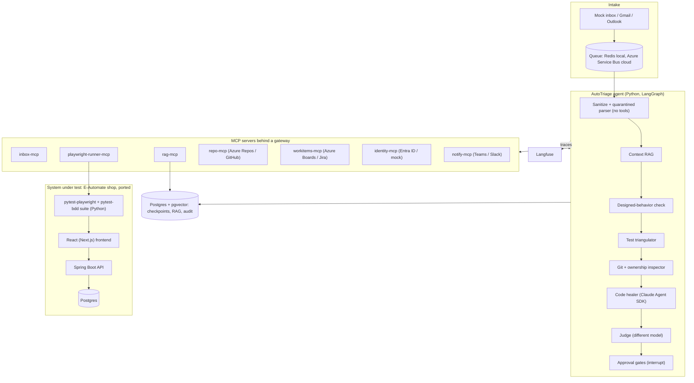
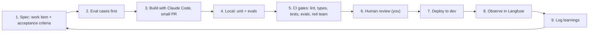
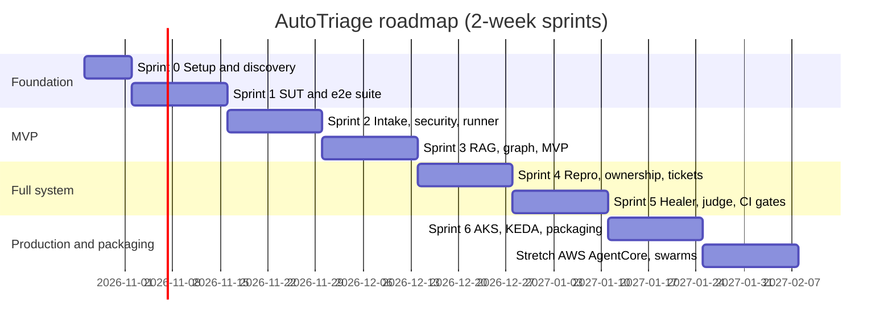

# AutoTriage: Master Plan (Strategy, Architecture, Process, Sprints)

**Owner:** Safwan Saba
**Version:** 1.2 (2026-10-21). Changes from 1.0: React instead of Angular; pytest-playwright instead of Playwright TS; **the SUT is the existing E-Automate shop, ported to Spring Boot + React, not a new OmniProcure app**; new item S0-8 and a rewritten Sprint 1.
**Status:** Planning. **Nothing in this plan is built yet.**
**Time budget:** 12 to 15 hours/week, about 13 weeks (Sprint 0 + six 2-week sprints), plus one optional stretch sprint.

This is the single source of truth. It supersedes the earlier documents where they conflict:
- [fde_month1_plan.md](file:///Users/lion/.gemini/antigravity-ide/brain/0b4a5587-170c-4439-b259-05321d749566/fde_month1_plan.md): original Month 1 plan (two separate projects, now folded into AutoTriage)
- [autotriage_master_technical_brief.md](file:///Users/lion/.gemini/antigravity-ide/brain/0b4a5587-170c-4439-b259-05321d749566/autotriage_master_technical_brief.md): deep technical detail (state schema, all decision paths, MCP contracts, confidence model, data model)
- [autotriage_enterprise_blueprint.md](file:///Users/lion/.gemini/antigravity-ide/brain/0b4a5587-170c-4439-b259-05321d749566/autotriage_enterprise_blueprint.md): Spring Boot/React SUT (superseded where it conflicts with this plan), Azure DevOps pipeline draft

> [!IMPORTANT]
> Section 13 lists corrections to advice given earlier in this conversation (cryptomining cause, interview claims, prompt-injection claims, some config snippets). Read it before using those earlier answers.

---

## Table of Contents
1. [Strategy](#1-strategy)
2. [Product scope](#2-product-scope)
3. [Architecture](#3-architecture)
4. [Architecture decision records (ADRs)](#4-architecture-decision-records)
5. [Working process (ADLC)](#5-working-process-adlc)
6. [Sprint plan](#6-sprint-plan)
7. [Environments, cloud and cost](#7-environments-cloud-and-cost)
8. [Kubernetes plan](#8-kubernetes-plan)
9. [Security plan (including the cryptomining issue)](#9-security-plan)
10. [Evals and metrics](#10-evals-and-metrics)
11. [Risk register](#11-risk-register)
12. [Career track: resume, portfolio, interviews](#12-career-track)
13. [Corrections to earlier advice](#13-corrections-to-earlier-advice)
14. [Open decisions](#14-open-decisions)

---

## 1. Strategy

### 1.1 Goal
Move from being seen as "AI Test Lead / QA" to being hired as an **AI Quality Engineering Lead, Applied AI Engineer, or Forward Deployed Engineer (FDE)**. The vehicle is one flagship project, **AutoTriage**, that shows you can build and deploy an agentic system end to end, with QA as its core.

### 1.2 Why this project
- It uses your strongest skill (Playwright, BDD, test frameworks, Sentinel) as the **verification engine** of an agent.
- It touches everything an FDE/architect is hired for: integrations (email, ADO/Jira, Git, identity), RAG, agents, security, cloud, evals, human approval flows.
- It is a business problem anyone understands: customer bug reports take days to triage.

### 1.3 Honest assessment of the idea
The idea is strong for a portfolio. Three caveats:
1. **Scope is large.** The plan cuts it into a working MVP by Sprint 3 so there is always something demoable.
2. **Parts already exist in the market** (Jira-to-Playwright-to-PR agents, issue-to-PR coding agents, AI test platforms). The differentiator is the **end-to-end composition, evidence-first triage, safety design and measured results**, not "nobody has done this". Do the competitive scan in Sprint 0.
3. **Value must be measured, not asserted.** All numbers come from a seeded benchmark (section 10) until it runs somewhere real.

### 1.4 Positioning
Resume title (from the brainstorm): **AI Quality Engineer | LLM Evaluation & Agentic AI (ADLC) Testing | Quality Engineering Lead**.
Keep "SDLC" in the body for ATS keyword matching; ADLC is the differentiator.

### 1.5 Claim ladder (what you may say at each stage)
| Stage | What you can truthfully say |
|---|---|
| Now | "I'm designing an agentic bug-triage system; here's the architecture." |
| After Sprint 3 (MVP) | "I built a working triage agent that runs existing Playwright suites and classifies reports, with evals in CI." |
| After Sprint 5 | "On a benchmark of N seeded bugs, it reproduced X%, routed owners with Y% accuracy, median triage Z minutes, false-bug rate W%." |
| After a real pilot | Only then: business claims such as "reduced MTTT from days to minutes for team T." |

> [!WARNING]
> Do not present design targets ("4 days to 4 minutes") as achieved results in interviews or on the resume. Interviewers probe, and a fabricated metric costs more than a modest real one.

---

## 2. Product scope

### 2.1 Problem
Customer reports a bug by email → support → BA/BO → meeting → QA retests → someone checks automation coverage → someone works out why tests passed/failed → developer assignment. This takes days and burns senior time.

### 2.2 Core flow
1. Read the support inbox; sanitize and parse the report.
2. RAG over sprints, PRDs, meeting transcripts, release notes: is this intended behavior?
3. Find an existing BDD scenario/spec.
   - Exists → run in QA, then staging/hotfix. Fail = regression. Pass = explore variants (data, role, viewport, flags).
   - Missing → synthesize a Playwright reproduction, run in a sandbox (3 runs for stability).
4. Confirmed → locate code, git blame, check if the author is still active.
   - Active → create ADO/Jira bug with trace, video, logs; assign.
   - Departed → healer proposes a patch with a computed confidence score → draft PR (human review) or ticket with RCA.
5. Customer replies and PRs always pass through human approval.

Full branching (15 paths, P0 to P14) is in the technical brief, section 8.

### 2.3 MVP (end of Sprint 3)
Paths P0 (quarantine), P1 (needs info), P2 (working as designed), P3 (existing test fails), P4 basic (existing test passes → needs info), with durable state and the customer-reply approval gate.

### 2.4 Non-goals
- No autonomous merge, ever.
- No real client systems, code or data (confidentiality: do not use client frameworks such as the Owens Corning one in a public repo).
- No production customer email sending without approval.
- No model training or fine-tuning (so no need for Colab).

---

## 3. Architecture

### 3.1 Logical view


### 3.2 Tech stack (final)
| Layer | Choice | Why |
|---|---|---|
| Agent language | Python 3.12+, `uv`, Pydantic v2, FastAPI | FDE market expects Python; strong typing |
| Orchestration | LangGraph + Postgres checkpointer | Durable state, crash recovery, `interrupt()` for HITL |
| Agent harnesses | LangChain (tools/retrievers), Claude Agent SDK (code healer), Deep Agents (optional planner) | Covers the "harness engineering" skill |
| Tool protocol | MCP (Python SDK / FastMCP) | Decouples tools; swap ADO ↔ Jira without touching the graph |
| Models | Azure OpenAI (main reasoning), Claude via Anthropic API or AWS Bedrock (code healer, judge from a different vendor), Ollama local (sanitizer, dev) | Frontier vs open vs local comparison; vendor diversity for judge |
| Test suite of the SUT | **pytest + pytest-playwright (Python)**, `pytest-bdd` for Gherkin, `pytest-xdist` for parallel runs | One language for agent and tests; reuses your BDD experience |
| SUT backend | Java 21, Spring Boot 3.x, Maven, JPA, Flyway | Realistic enterprise stack traces |
| SUT frontend | **Existing E-Automate UI (Next.js/React, Tailwind, shadcn/ui), ported** from Firebase calls to the Spring Boot REST API | Reuse, not rebuild; realistic SPA failure modes |
| Data | Postgres + pgvector (one instance, separate schemas) | Fewer moving parts |
| Queue | Redis (local), Azure Service Bus (cloud) | KEDA-compatible |
| Observability | Langfuse + OpenTelemetry | Traces, costs, eval scores |
| Evals | pytest harness, DeepEval or RAGAS, Promptfoo red team | CI-gated ADLC |
| Work tracking (target of the agent) | Azure Boards primary, Jira adapter optional | Your ADO experience |
| Repo / CI | Azure Repos + Azure Pipelines primary; GitHub mirror optional for public portfolio | ADO experience + public visibility |
| Identity (owner status) | Microsoft Graph / Entra ID; mock service in dev | Real enterprise signal |
| Infra | Docker Compose → kind/k3d → AKS; Bicep or Terraform; KEDA | Progressive complexity |
| AWS | Bedrock for models; EKS or Bedrock AgentCore in stretch sprint | Multi-cloud story without double infra cost |

### 3.3 Repo layout (monorepo)
```
autotriage/
├── README.md
├── ADLC.md                         # process, gates, definition of done
├── CLAUDE.md                       # conventions for coding agents
├── docs/
│   ├── adr/                        # ADR-001 ...
│   ├── discovery.md  metrics.md  competitive-scan.md
│   ├── rai-checklist.md  runbook.md  handover.md
│   └── case-study.md
├── agent/                          # Python (uv project)
│   ├── pyproject.toml
│   └── src/autotriage/
│       ├── graph/{state.py,build.py,routing.py,nodes/}
│       ├── security/{sanitize.py,quarantine_parser.py,injection.py,pii.py}
│       ├── rag/{ingest.py,chunk.py,embed.py,retrieve.py,rerank.py}
│       ├── models/router.py
│       ├── confidence.py
│       └── api.py  cli.py
├── mcp_servers/
│   ├── inbox/ playwright_runner/ rag/ repo/ workitems/ identity/ notify/
│   └── gateway/                    # authZ, rate limit, audit, approval tokens
├── sut/
│   ├── backend-spring/
│   ├── frontend-react/
│   └── e2e/                        # pytest-playwright tests, pytest-bdd features, page objects
├── knowledge/                      # synthetic PRDs, sprint notes, transcripts, release notes
├── evals/
│   ├── datasets/*.jsonl
│   ├── run_all.py
│   └── redteam/promptfooconfig.yaml
├── infra/
│   ├── docker-compose.yml
│   ├── k8s/ (base + overlays: local, aks, eks)
│   └── bicep/ or terraform/
└── pipelines/
    ├── azure-pipelines.yml
    └── evals.yml
```

### 3.4 Decision paths (summary)
| Path | Meaning | Ends with |
|---|---|---|
| P0 | Malicious / injection / spam | Quarantine + security notice |
| P1 | Missing info | Draft clarifying email (approval) |
| P2 | Working as designed | Draft explanation with citations (approval) |
| P3 | Existing test fails | Confirmed regression → ownership |
| P3b | Fails QA, passes hotfix | Fix already shipped → tell support |
| P4 | Existing test passes | Variant exploration → bug (P4a) or needs info (P4b) |
| P5 | No test exists | Synthesize repro → bug (P5a) / unreproducible (P5b) / flaky test (P5c) |
| P6 | Author active | Work item with evidence, assigned |
| P7 | Author departed | Healer → draft PR (≥ threshold) or ticket with RCA; sensitive areas never patched |
| P8 to P14 | Vendor bug, duplicate, security-sensitive, known issue, budget cap, outage, feature request | See technical brief §8 |

---

## 4. Architecture decision records

| ADR | Decision | Reason | Trade-off |
|---|---|---|---|
| 001 | Agent and SUT tests both in Python (pytest-playwright); SUT is Java + React | One test/agent language, matches the AI job market | Lose some Playwright Test built-ins (UI mode, built-in sharding, visual regression); use `pytest-xdist` and trace/video flags |
| 002 | LangGraph for orchestration | Cycles, durable checkpoints, HITL interrupts | Learning curve vs simpler frameworks |
| 003 | All tools via MCP | Decoupling, per-tool auth, audit | Extra processes to run |
| 004 | Postgres for checkpoints, RAG, audit | One datastore to operate | Not the fastest vector DB at very large scale (irrelevant here) |
| 005 | Azure primary cloud; AWS for Bedrock + stretch | ADO experience; avoid paying for two clusters | AgentCore story deferred to stretch sprint |
| 006 | No autonomous merge; draft PRs only | Safety and credibility | Less "wow", more trust |
| 007 | Quarantined, tool-less parser for untrusted input | Breaks the lethal trifecta | Extra LLM call |
| 008 | Seeded demo SUT, not client systems | Confidentiality, ground truth for metrics | Must build the SUT |
| 009 | Confidence is computed from signals, not self-reported | Explainable, calibratable | Needs calibration data |
| 010 | Judge model from a different vendor than the healer | Reduces correlated errors | Two provider accounts |

Write each as a short file in `docs/adr/` during the sprint where it is applied.

---

## 5. Working process (ADLC)

### 5.1 Lifecycle per feature


### 5.2 Rules
- **Eval-first:** no prompt or node change without eval cases that cover it.
- **Small PRs:** under ~400 changed lines; one feature per PR.
- **Claude Code accountability:** you review every diff; `CLAUDE.md` holds conventions; agent-written code gets the same CI gates as yours.
- **Track work in Azure Boards** (dogfood ADO): Epic per sprint goal, User Story per backlog item, link PRs with `AB#ID`.

### 5.3 Definition of Done
- [ ] Acceptance criteria met and demoed
- [ ] Unit tests pass; coverage of new code ≥ 80%
- [ ] `ruff` + `mypy --strict` clean (Python); `eslint` + `tsc` clean (React app only); `mvn verify` green (Java)
- [ ] Eval cases added; eval gate passes
- [ ] Traced in Langfuse
- [ ] Docs/ADR updated
- [ ] No secrets in code (gitleaks passes)

### 5.4 Solo ceremonies
| When | What | Time |
|---|---|---|
| Sprint start | Planning: pick backlog, confirm acceptance criteria | 1h |
| Weekly | Review: shipped, metrics, blockers, next three | 30m |
| Sprint end | Demo recording (2 to 3 min Loom) + retro notes | 1.5h |

---

## 6. Sprint plan

Estimates are focused hours. Each sprint is about 24 to 30 hours. If a sprint overruns, cut scope, not quality gates.



---

### Sprint 0 (1 week): Setup and discovery
**Goal:** tools working, problem framed, competition understood.

| ID | Item | Hours |
|---|---|---|
| S0-1 | Install `uv`, Docker/OrbStack, Node LTS, JDK 21, Maven, Ollama, `gh`/`az` CLIs | 2 |
| S0-2 | Create Azure DevOps project (Boards, Repos, Pipelines); GitHub mirror for public | 1 |
| S0-3 | Monorepo skeleton (section 3.3), `CLAUDE.md`, `ADLC.md`, pre-commit with gitleaks | 2 |
| S0-4 | `docs/discovery.md`: personas (customer, support, BA, QA, dev, tech lead), current flow, pain, baseline assumptions | 2 |
| S0-5 | `docs/competitive-scan.md`: issue-to-PR agents, AI testing platforms, ITSM AI, Jira-to-Playwright repos | 3 |
| S0-6 | Accounts and budget alerts: Azure (budget alert), Azure OpenAI access, Anthropic, Langfuse | 1 |
| S0-7 | Security review of old cloud projects (section 9.1) | 2 |
| S0-8 | **Reference intake:** move the copied E-Automate files into `reference/e-automate/` (read-only), complete the copy (`src/components`, `src/hooks`, `src/lib`, `package.json`, `tailwind.config.ts`, `components.json`, `firestore.rules`), write `docs/porting-inventory.md` (routes, data model, roles, every Firebase call, what to drop) | 3 |

**Done when:** CI runs an empty test in Azure Pipelines; discovery and competitive scan written; budget alerts on.

---

### Sprint 1: Port the existing shop to Spring Boot + React, make it run, add tests
**Goal:** the E-Automate shop you already built runs on a Java backend and a React frontend with known, switchable bugs and a real pytest-playwright suite. **Reuse first: do not rebuild what E-Automate already has.**

**What already exists (reuse):** the UI (products with search, category, price and sort filters; product detail; cart; checkout; order confirmation; orders; login; signup; profile; admin), the data shapes in `types.ts`, the 8 seed products, and the API status-code behavior of the old cart route (401 not logged in, 400 missing `productId`, 404 unknown product).

**What is new (write):** the Spring Boot API (Firebase replaced by Postgres), JWT auth, a mock payment gateway (no Stripe), Docker Compose, the bug-flag system, and the test suite.

**Shop scope (keep it small):** login/signup with roles `USER` and `ADMIN`, product list with filters and sort, product detail, cart, checkout with a mock card, order history, admin product CRUD.

| ID | Item | Hours |
|---|---|---|
| S1-1 | Spring Boot API (Java 21, Postgres, Flyway): auth (JWT), products, cart, orders, admin; seed data from `products.ts`; OpenAPI | 8 |
| S1-2 | Port the React UI: replace Firebase/`getProducts` calls with one typed API client; remove Firebase, Genkit, Stripe; add `data-testid` to key elements | 4 |
| S1-3 | pytest-playwright + pytest-bdd suite: ~15 scenarios, page objects, JUnit XML + JSON reports, traces/videos on failure | 5 |
| S1-4 | **Bug seeding system:** feature flags `BUG_01..BUG_10` toggle each defect, so ground truth is controllable | 3 |
| S1-5 | Seed 10 bugs (mix), see list below | 3 |
| S1-6 | `docker-compose` for the SUT; Azure Pipeline running the suite | 2 |
| S1-7 | `evals/datasets/seeded_bugs.jsonl`: each bug with true root cause file/line, owner, covered-by-test yes/no | 1 |

**Seeded bugs (shop domain):** NPE when an order has no shipping address or a pending payment; percentage discount truncates to 0 on small carts (integer division); a `USER` can call an admin product endpoint (missing role check); "Place order" button stays disabled after a slow stock check (stale async state); coupon or postal code loses characters on paste; wrong sort on price; timezone shift on order date; missing error toast on failed add-to-cart; pagination off by one; locale currency format.

**Baseline rule:** the ported app must be **correct with all flags off**. The old code has natural weaknesses (for example, the old cart route appends duplicate lines instead of merging quantities, and does not validate quantity). Fix or document these in Step 1 so that every bug the agent finds later is one you seeded on purpose. Accidental bugs ruin the ground truth.

**Coverage design (important for later paths):** about half the seeded bugs should be covered by existing scenarios (exercise P3) and half not (exercise P5). One bug should only appear for one role or viewport (exercise P4a).

**Done when:** `docker compose up --build` runs the whole shop; with all flags off the suite is green; turning on each flag produces the intended symptom; ground-truth file complete.
**Demo:** toggle a bug, show the suite catching it (or not, by design).

---

### Sprint 2: Intake, security, Playwright runner MCP
**Goal:** untrusted email in → validated `BugReport` out; agent can run tests through MCP.

| ID | Item | Hours |
|---|---|---|
| S2-1 | `inbox-mcp` over a mock inbox (folder of `.eml`/JSON); Gmail/Outlook adapter later | 2 |
| S2-2 | `sanitize.py`: strip HTML/scripts/hidden text, normalize, size limits | 2 |
| S2-3 | Injection classifier (heuristics + small local model via Ollama) → `injection_score` | 3 |
| S2-4 | Quarantined parser: tool-less LLM, structured output → `BugReport` (Pydantic), field length limits | 3 |
| S2-5 | Intake eval set: 100 emails (clean, messy, partial, multilingual, 20 adversarial) with gold `BugReport` | 5 |
| S2-6 | `playwright-runner-mcp` (port of Sentinel executor logic to Python): `search_tests`, `run_test(ref, env)`, returns status + trace/video paths + parsed errors | 6 |
| S2-7 | Semantic test search: embed feature/scenario text and page-object names | 3 |
| S2-8 | ADR-001, ADR-003, ADR-007 | 1 |

**Acceptance:** extraction F1 ≥ 0.90; all adversarial emails produce either quarantine or a clean `BugReport` with no instructions acted upon; `run_test` works locally and in a container.
**Demo:** a messy email becomes structured JSON; an injection email gets quarantined; the agent runs a named scenario and returns the trace.

---

### Sprint 3: RAG, LangGraph core, MVP
**Goal:** first end-to-end vertical slice with durable state and a human gate.

| ID | Item | Hours |
|---|---|---|
| S3-1 | Write synthetic knowledge: 6 PRDs, 4 sprint plans/retros, 6 meeting transcripts, release notes, known-issues list (some describe intended behavior that looks like bugs) | 4 |
| S3-2 | Ingestion: heading-aware chunking, embeddings, pgvector HNSW + keyword `tsvector`, idempotent upsert | 4 |
| S3-3 | Retrieval: hybrid + RRF + rerank; `rag-mcp` | 3 |
| S3-4 | RAG eval set (60 questions) → Recall@5, MRR | 2 |
| S3-5 | LangGraph state + nodes: sanitize → parse → retrieve → designed-check → find tests → run existing → classify | 6 |
| S3-6 | Postgres checkpointer; crash-recovery test (kill worker mid-run, resume, no duplicate actions via `action_log`) | 3 |
| S3-7 | Approval gate G1 for customer drafts (`interrupt()`); simple review UI (Streamlit or a Next.js page on your portfolio) | 3 |
| S3-8 | Langfuse tracing per node; eval gate in Azure Pipelines | 2 |

**Acceptance:** P0 to P4-basic work end to end on the benchmark; "working as designed" precision ≥ 0.95 (rarely dismisses real bugs); recovery test passes.
**Demo (MVP):** email arrives → agent cites a PRD and drafts "working as designed" → you approve; second email → existing scenario fails in QA → classified as regression.
**Claim unlocked:** "built a working triage agent with evals in CI."

---

### Sprint 4: Reproduction, ownership, work items
**Goal:** handle uncovered bugs and route confirmed ones to the right person with evidence.

| ID | Item | Hours |
|---|---|---|
| S4-1 | Repro synthesizer: reuse page objects and conventions; structured `SynthesizedTestSpec`; writes only to sandbox | 6 |
| S4-2 | Stability rule: run 3 times; product bug vs test defect classifier (assertion/HTTP error vs locator timeout); bounded test self-heal | 4 |
| S4-3 | Variant exploration for P4: roles, viewport, locale, feature flags | 3 |
| S4-4 | Multi-env runs: QA vs hotfix (P3b) by running the SUT twice with different flags | 2 |
| S4-5 | `repo-mcp`: code search, `git blame`, pickaxe log, CODEOWNERS (Azure Repos + local git) | 4 |
| S4-6 | `identity-mcp`: mock directory (active/departed/leave) with a Microsoft Graph adapter behind the same interface | 2 |
| S4-7 | `workitems-mcp`: Azure Boards bug creation with repro steps, attachments (trace, video), area/iteration; duplicate detection | 4 |
| S4-8 | Evals: repro rate, false-bug rate, owner accuracy | 2 |

**Acceptance:** ≥ 80% of seeded bugs reproduced; false-bug rate ≤ 5%; owner accuracy ≥ 0.90; ADO bug created with working attachments.
**Demo:** uncovered bug → agent writes a new Playwright test → fails 3/3 → blame → author active → ADO bug assigned with video.

---

### Sprint 5: Code healer, judge, confidence, CI gates, red team
**Goal:** the "departed author" path with safety, plus full ADLC gates.

| ID | Item | Hours |
|---|---|---|
| S5-1 | Healer on Claude Agent SDK in a sandbox clone: minimal diff, must add/keep the repro test, forbidden paths (auth, payments, migrations, infra) enforced at the gateway | 7 |
| S5-2 | Run repro test + `mvn test` + relevant e2e subset, bounded attempts and token budget | 3 |
| S5-3 | Judge node (different vendor) reviewing diff vs trace | 2 |
| S5-4 | Confidence model (signals + penalties), explanation rendered into the PR body | 3 |
| S5-5 | Gate G2: draft PR in Azure Repos with `AB#` link; Teams/Slack approval card via `notify-mcp` | 3 |
| S5-6 | MCP gateway: per-server scopes, approval tokens for write tools, audit log | 3 |
| S5-7 | Promptfoo red team (100 attacks) + attack-success-rate gate in pipeline | 3 |
| S5-8 | Calibration log: predicted confidence vs outcome on seeded bugs | 1 |

**Acceptance:** ≥ 50% of healable seeded bugs fixed with green suites; zero regressions introduced; zero writes outside `autotriage/*` branches; attack success ≤ 1%; a deliberately bad prompt change fails the pipeline.
**Claim unlocked:** benchmark metrics (section 1.5).

---

### Sprint 6: Kubernetes, production hardening, packaging
**Goal:** runs on AKS safely; story packaged for hiring.

| ID | Item | Hours |
|---|---|---|
| S6-1 | Kustomize/Helm manifests; local kind/k3d first | 3 |
| S6-2 | AKS (small node pool, autoscaling), Workload Identity, Key Vault CSI, private or IP-restricted API server | 4 |
| S6-3 | Playwright runs as K8s Jobs; KEDA scaling on Service Bus queue depth (scale to zero) | 3 |
| S6-4 | NetworkPolicy (default deny egress; allow SUT, DNS, blob storage endpoint), Pod Security Admission `restricted` | 2 |
| S6-5 | Langfuse dashboards: path mix, cost/ticket, repro rate, approval rate, calibration | 2 |
| S6-6 | Model comparison table (frontier / open / local) on 3 nodes: accuracy, latency, cost, privacy | 3 |
| S6-7 | Case study page on portfolio, 3-min Loom, README with architecture and scorecard | 4 |
| S6-8 | Resume v2, LinkedIn post, interview story rehearsal (section 12) | 3 |

**Acceptance:** full benchmark run on AKS; pods scale 0 → N → 0; cluster can be torn down and recreated from code in under 30 minutes.

---

### Stretch sprint: AWS and advanced agent patterns
| ID | Item |
|---|---|
| X-1 | Deploy the graph to AWS Bedrock AgentCore (Runtime, Gateway, Policy, Memory), or EKS with the same manifests (verify current AgentCore docs first) |
| X-2 | Swarm variant: specialist agents with a supervisor; compare cost/accuracy vs single graph |
| X-3 | Recursive self-improvement: failures → prompt edit proposal → re-eval → PR only if better and no safety regression |
| X-4 | Long-term memory: resolved-ticket memory improving future triage |
| X-5 | Enterprise context layer: unified MCP gateway across all sources |

---

### 6.1 Skill coverage by sprint
| Skill (from your list of 12) | Sprint |
|---|---|
| 1 FDE/architect skills + roadmap | 0, 6 |
| 2 Claude Code + ADLC | all (process §5) |
| 3 Harness engineering (LangChain, Deep Agents, Claude Agent SDK) | 3, 5 |
| 4 Frontier vs open vs local models | 2 (local sanitizer), 6 (comparison) |
| 5 Evals + Langfuse | 2 to 6 |
| 6 Agentic RAG over MCP | 3 |
| 7 LangGraph durable state, HITL | 3, 5 |
| 8 Swarms, LLM-as-judge, self-improvement | 5 (judge), stretch |
| 9 Client leadership: discovery → handover | 0, 6 |
| 10 Security, lethal trifecta, gateways | 2, 5, 6 |
| 11 Enterprise context layer + MCP gateway | 5, stretch |
| 12 AWS Bedrock AgentCore | stretch |

---

## 7. Environments, cloud and cost

| Env | Where | Purpose |
|---|---|---|
| local | Docker Compose, then kind/k3d | Daily development, free |
| ci | Azure Pipelines (Microsoft-hosted agents) | Gates on every PR |
| dev-cloud | AKS (Sprint 6 only) | Prove deployment; tear down when not in use |
| stretch | AWS (AgentCore/EKS) | One-off demo, then destroy |

**Cost controls (set in Sprint 0):**
- Budget alerts at 50/80/100% on Azure and AWS.
- Use local Ollama and small models in dev; cache embeddings; token caps per run.
- Create clusters from code, destroy at the end of each session (`terraform destroy` / `az group delete`).
- Never leave GPU or large node pools running.

I have not quoted prices; check current Azure/AWS/model pricing when you set budgets.

---

## 8. Kubernetes plan

**Why K8s here:** isolation of untrusted browser runs, scale-to-zero, per-run resource caps, network policy.

| Concern | Design |
|---|---|
| Browser isolation | One K8s Job per test run; `ttlSecondsAfterFinished`; fresh browser context |
| Scaling | KEDA on queue depth; min 0 replicas for runners |
| Resources | Requests/limits per pod (e.g. 1 CPU / 2Gi, adjust from measurements) |
| Identity | Workload Identity (AKS) / IRSA or Pod Identity (EKS); no static keys in pods |
| Secrets | Key Vault / Secrets Manager via CSI driver |
| Network | Default-deny egress; allow only SUT, DNS, artifact storage endpoint. Requires a CNI that enforces NetworkPolicy (AKS with Azure/Calico/Cilium policy enabled; EKS VPC CNI network policy or Calico) |
| Pod security | `runAsNonRoot`, drop all capabilities, no privilege escalation, Pod Security Admission `restricted` |
| Exposure | No public Services for runners; never expose Chrome DevTools (9222), Selenium Grid (4444), kubelet, dashboards |
| Ephemeral SUT | Optional per-ticket namespace with the SUT via Helm, deleted after triage |

Starter Job manifest:
```yaml
apiVersion: batch/v1
kind: Job
metadata:
  generateName: pw-run-
  namespace: autotriage-runs
spec:
  ttlSecondsAfterFinished: 300
  backoffLimit: 0
  activeDeadlineSeconds: 600
  template:
    metadata:
      labels: { app: playwright-runner }
    spec:
      restartPolicy: Never
      automountServiceAccountToken: false
      securityContext:
        runAsNonRoot: true
        runAsUser: 1000          # verify pwuser UID in the image you pin
        seccompProfile: { type: RuntimeDefault }
      containers:
        - name: runner
          image: mcr.microsoft.com/playwright/python:<pinned-version>
          args: ["pytest", "-k", "$(TEST_REF)", "--tracing=retain-on-failure", "--video=retain-on-failure"]
          resources:
            requests: { cpu: "500m", memory: "1Gi" }
            limits:   { cpu: "1",    memory: "2Gi" }
          securityContext:
            allowPrivilegeEscalation: false
            capabilities: { drop: ["ALL"] }
```

---

## 9. Security plan

### 9.1 The cryptomining suspensions you had before

> [!IMPORTANT]
> I can't see your earlier conversations or the provider emails, so this is based on your description. The earlier answer in this chat said Chromium CPU spikes were the likely trigger. That was misleading. **The most common cause of a cryptomining suspension is that the machines were actually compromised and someone ran a real miner on them**, not a false positive from high CPU.

**Common entry points (check all):**
| Entry point | Why it matters for you |
|---|---|
| Exposed Selenium Grid (port 4444) | Attackers have abused unauthenticated Selenium Grid instances to run miners. Very relevant for test infrastructure |
| Exposed Chrome DevTools port (9222) | Gives remote code control of the browser |
| Leaked cloud credentials (keys in git, `.env` files, CI logs) | Attackers create their own VMs/clusters in your project to mine |
| Exposed Docker API (2375), Kubernetes dashboard, kubelet, Jupyter, Ray | Unauthenticated code execution |
| Weak SSH passwords / open 22 to the world | Brute force |

**What to do now (Sprint 0, S0-7):**
1. Read the provider notices carefully: they usually name the resource and the detection type.
2. Check whether resources existed that you did not create (regions, VMs, GPUs).
3. Rotate all cloud keys and service-account keys; prefer keyless auth (Workload Identity / OIDC from pipelines).
4. Scan this repo and old repos' history with `gitleaks` or `trufflehog`.
5. Review firewall rules: nothing listening publicly except intended HTTPS endpoints.
6. If you are confident it was a false positive, use the provider's appeal process; don't try to "suppress" mining detections.

**Prevention (built into the plan):** private/IP-restricted clusters, no public runner Services, keyless identity, default-deny egress, budget alerts, org/subscription policies restricting regions and VM/GPU types.

### 9.2 Agent security (lethal trifecta)
AutoTriage has private data, untrusted input and the ability to act, so all three legs exist by design. Controls:
| Control | Detail |
|---|---|
| Quarantined parser | Tool-less model turns email into a schema. **This reduces risk but does not eliminate it**: injected text can still sit inside string fields like `steps`. |
| Treat parsed fields as data | Downstream prompts wrap them as quoted data; length limits; no URLs followed unless on the SUT allowlist |
| Least-privilege tools | Gateway scopes per server; write tools need approval tokens |
| Draft-only outputs | Emails are drafts; PRs are drafts on `autotriage/*` branches |
| Sandboxed execution | Generated tests run in network-restricted Jobs with a test account |
| Outbound filters | PII/secret scan on drafts; only customer-safe citations quoted |
| Red team in CI | Promptfoo + custom corpus; attack success ≤ 1% |
| Privacy | Employee status: minimum fields, access logged; real Entra data only with consent in a real deployment |

---

## 10. Evals and metrics

| Layer | Metric | Target | First measured |
|---|---|---|---|
| Intake | Field-extraction F1 | ≥ 0.90 | Sprint 2 |
| Security | Attack success rate | ≤ 1% | Sprint 2 (basic), 5 (full) |
| RAG | Recall@5 / MRR | ≥ 0.85 / ≥ 0.70 | Sprint 3 |
| Designed check | Precision of "working as designed" | ≥ 0.95 | Sprint 3 |
| Test match | Top-1 accuracy | ≥ 0.85 | Sprint 3 |
| Repro | Seeded bugs reproduced | ≥ 80% | Sprint 4 |
| Repro | False-bug rate | ≤ 5% | Sprint 4 |
| Ownership | Correct owner | ≥ 90% | Sprint 4 |
| Healer | Fixed with green suite | ≥ 50% | Sprint 5 |
| Healer | Regressions introduced | 0 | Sprint 5 |
| Confidence | Calibration error | ≤ 0.10 (needs enough samples) | Sprint 5+ |
| Ops | p95 triage time, $/ticket | measure, then set targets | Sprint 3+ |

**Rule:** wrongly dismissing a real bug is worse than a false alarm. Bias thresholds toward escalation.

The benchmark (seeded bugs + emails + knowledge base) is versioned in `evals/datasets/`. Every metric in the case study must come from a reproducible run.

---

## 11. Risk register

| Risk | Likelihood | Impact | Mitigation |
|---|---|---|---|
| Scope creep / burnout | High | High | MVP at Sprint 3; cut scope, keep gates; hard cap 15h/week |
| SUT takes too long | Medium | Medium | Keep to 4 screens; use Claude Code; seed bugs via flags |
| Three-language complexity (Py + Java + TS) | Medium | Medium | Python for agent and tests, Java for the API, TypeScript only inside the React app |
| Cloud cost surprise | Medium | Medium | Budget alerts, destroy clusters, local-first |
| Repeat of cloud compromise | Medium | High | Section 9.1 checklist before any cloud work |
| Overclaiming in interviews | Medium | High | Claim ladder (§1.5) |
| Using client code/data | Low | High | ADR-008; only synthetic data public |
| Model/API changes | Medium | Low | Model router abstraction; pin versions |
| Competitive overlap | High | Low | Position on composition, evidence, safety, metrics |

---

## 12. Career track

Run alongside the sprints, 1 to 2 hours per week.

| When | Career deliverable |
|---|---|
| Sprint 0 | Update resume title and summary (ADLC + SDLC); fix portfolio `<title>`/H1/meta; LinkedIn headline |
| Sprint 3 | First LinkedIn post: MVP demo + "evals block bad prompts" |
| Sprint 5 | Resume bullets with benchmark numbers; start applying to bridge roles (Applied AI Engineer, AI Solutions Engineer, AI Quality Lead) |
| Sprint 6 | Case study page, 3-min video, apply to FDE roles; mock interviews |
| Anytime | Read your resume PDF against 10 real FDE postings and list gaps (not done yet) |

### 12.1 Interview story (honest version)
Structure: **Problem → Design → What I built → What I measured → What I'd do next.**

> "Triage of customer-reported bugs is slow because it crosses support, product, QA and engineering. I built AutoTriage, an agent in Python and LangGraph that parses the report in a quarantined, tool-less step, checks sprint and PRD context with RAG, then uses Playwright to run the existing scenario or generate a reproduction. Confirmed bugs are routed by git blame and directory status; for departed owners a healer proposes a patch, and a computed confidence score decides between a draft PR and a ticket. Nothing reaches a customer or the main branch without human approval. On a benchmark of [N] seeded bugs it reproduced [X]%, picked the right owner [Y]% of the time, with a false-bug rate of [Z]%."

### 12.2 Likely deep-dive questions (prepare with your real data)
| Question | Key points |
|---|---|
| Prompt injection? | Quarantined parser + data framing + least privilege + draft-only + red-team metric. Admit it reduces, not eliminates, risk |
| Why LangGraph? | Cycles, checkpoints, crash recovery, `interrupt()` HITL; show the recovery test |
| Flaky tests? | 3-run stability rule; product-bug vs test-defect signals; bounded test healing |
| Why MCP? | Decoupling, per-tool auth/audit, swap ADO ↔ Jira |
| How is confidence computed? | Signals + penalties; calibration log; thresholds conservative |
| What failed? | Have 2 real failures and what you changed (from your retro notes) |
| Cost? | $/ticket from Langfuse; model routing decisions from the comparison table |

---

## 13. Corrections to earlier advice

| Earlier statement | Correction |
|---|---|
| Interview pitch: "bringing triage time down from 4 days to 4 minutes" stated as achieved | It's a design target. Use benchmark numbers only after Sprint 5 (§1.5) |
| "No one has connected the whole chain" | Not verified; parts exist publicly. Do the competitive scan (S0-5) |
| Cryptomining: "Chromium 100% CPU triggers it" | Real compromise is the more common cause; follow §9.1. CPU spikes alone are not a reliable explanation |
| "I know exactly what happened / I remember" | I don't have access to your past conversations or the notices |
| Azure: create a Defender suppression rule for "Digital Currency Mining" alerts | Don't suppress mining alerts; it can hide a real compromise. Fix the cause or appeal |
| `CHROMIUM_FLAGS` env var in the pod spec | Playwright doesn't read that variable; pass flags via `launch({ args })` in config |
| Quarantined parser: "schema validator simply drops" injections | Schema validation narrows the attack surface; injected text can still live inside string fields. Defense in depth (§9.2) |
| NetworkPolicy that blocks all egress except SUT | Runners also need artifact storage (and possibly model endpoints); allow those explicitly, and confirm the CNI enforces policy |
| Azure Pipeline draft: `uv` path `$HOME/.cargo/bin`; stage condition reading an output variable never set | Current `uv` installer uses `$HOME/.local/bin`; the healer stage must set an output variable (`##vso[task.setvariable variable=STATUS;isOutput=true]`) before it can be referenced |
| "Brilliant, 10/10" | Strong portfolio idea, but large scope and existing competitors; value depends on execution and measured results (§1.3) |

---

## 14. Open decisions

| # | Decision | Recommendation |
|---|---|---|
| 1 | Public repo host | GitHub mirror for visibility; ADO as the "enterprise" side |
| 2 | Review UI | Streamlit first; portfolio Next.js page in Sprint 6 if time |
| 3 | Primary reasoning model | Azure OpenAI; Claude for healer; decide by Sprint 6 comparison |
| 4 | Jira adapter | Only if a target employer uses Jira |
| 5 | Stretch sprint | Do it only if Sprints 0 to 6 are complete and you are interviewing for AWS-heavy roles |
| 6 | Start date | Sprint 0 is drafted to begin 2026-10-26; adjust the Gantt if needed |
