# Forward Deployed Engineer (FDE) Operational Standards & Runbook

## 1. The FDE Role & Engineering Principles

A Forward Deployed Engineer (FDE) operates at the intersection of production software reliability, cloud observability, and autonomous agent orchestration. The FDE's mission is to eliminate repetitive operational triage while guaranteeing zero hallucination, strict deterministic boundaries, and automated closed-loop remediation.

### The Four Zero-Hallucination Guardrails

1. **Deterministic Pre-Execution Security**:
   Input text is scrubbed of credentials, tokens, and control characters via `sanitize.py`, and evaluated against prompt-injection signatures in `injection.py` **prior to any agent reasoning or tool call**.
2. **Physical Java AST Line Boundary Grounding**:
   The agent does not guess file names or line numbers. `FdeRagService.java` dynamically parses the controller and service source trees on disk, resolving exact AST line boundaries (e.g., `OrderController.java:101-116`) with relative path fallbacks for containerized environments.
3. **Strict Vector Grounding Threshold (0.85 Floor)**:
   Retrieval over PRDs, ADRs, and backlog items in `mcp_servers/rag/server.py` and `FdeRagService.java` enforces a minimum 0.85 cosine similarity and exact token match. If documentation does not support an assertion, the system resolves to `P1 (Needs More Info)` rather than guessing.
4. **Sub-50ms Episodic Memory Ledger**:
   `FdeEpisodicMemoryService.java` and Flyway migration `V4__fde_knowledge_and_audit_ledger.sql` maintain a persistent audit ledger. When a previously triaged incident signature re-occurs, the agent retrieves the verified root cause in under 50 ms.

---

## 2. Running AutoTriage Locally & in Cloud Environments

### Starting the Local Engineering Environment
1. **Launch Containers (PostgreSQL 16 & Redis)**:
   ```bash
   docker compose up -d
   ```
2. **Start Spring Boot REST Backend (`:8080`)**:
   ```bash
   cd sut/backend-spring && mvn spring-boot:run -Dspring-boot.run.profiles=dev
   ```
3. **Start React Vite Frontend & Mission Control (`:5173`)**:
   ```bash
   cd sut/frontend-react && npm run dev
   ```

### Executing Agent Tools & Test Suites
* **Run Shift-Left OpenAPI Spec & Test Generator**:
  ```bash
  uv run python agent/src/autotriage/shift_left_generator.py
  ```
* **Run Full Playwright E2E Suite**:
  ```bash
  cd sut/e2e && uv run pytest -v
  ```
* **Run Golden Dataset Evaluation Benchmark (20 Scenarios)**:
  ```bash
  python3 evals/eval_golden_dataset.py
  ```
* **Publish Test Results to Azure DevOps Test Plans**:
  ```bash
  python3 agent/src/autotriage/ado_test_publisher.py
  ```

---

## 3. Glass-Box Mission Control Cockpit & The 6 Fault Vectors

The Mission Control cockpit (`http://localhost:5173/mission-control` or cloud DEV) provides interactive fault injection and real-time telemetry observation.

```mermaid
flowchart LR
    UI["Mission Control Cockpit (/mission-control)"] -->|"Trigger Attack Vector"| SUT["Spring Boot SUT (FdeAgenticController.java)"]
    SUT -->|"Elevated Errors & Traces"| Obs["Observability Stream (App Insights & Traces)"]
    Obs -->|"CI Alert Ingestion"| Agent["AutoTriage LangGraph Engine"]
    Agent -->|"Physical AST Root Cause"| Fix["Emergency Hotfix Engine & ADO Bug"]
    UI -->|"1-Click Self-Healing"| SUT
```



### Reference Table: The 6 Controlled Fault Vectors

| Vector ID | Attack Key / Alias | Target Class & Lines | Failure Mechanics | Financial & Operational Blast Radius |
| :--- | :--- | :--- | :--- | :--- |
| **US-1001** | `PRICE_INJECTION`<br>*(alias: `PRICE_TAMPERING`)* | `ProductController.java:125-145` | Missing server-side catalog price assertion permits client overrides to $0.01. | Arbitrage loss of $2,499.99 per unit; projected impact >$500,000/yr. |
| **US-1002** | `CART_UNDERFLOW` | `CartController.java:126-157` | Negative item quantity input (`-5`) bypasses check, corrupting cart subtotal. | Negative invoice total, ledger underflow, orphaned warehouse reservations. |
| **US-1003** | `CONCURRENCY_OVERSELL` | `OrderController.java:101-116` | Non-locking stock verification allows simultaneous checkout threads to drive stock negative. | Inventory oversold below zero, unfulfillable orders, customer chargebacks. |
| **US-1004** | `NULL_SHIPPING_NPE` | `OrderController.java:66-71` | Unchecked `line2().trim()` dereference triggers unhandled `NullPointerException`. | 100% checkout failure for customers without secondary address lines (HTTP 500). |
| **US-1005** | `CANCELLATION_RESTOCK_LOOP` | `OrderController.java:203-226` | Missing idempotency guard replenishes stock on every status flip to cancelled. | Phantom inventory inflation (+30 units per 3 cycles), warehouse ledger corruption. |
| **US-1006** | `ADMIN_SQL_SMUGGLING` | `ContactAndAdminOpsController.java:77-91` | Naive `startsWith("SELECT")` check allows exfiltration of `password_hash` from `users`. | Critical data breach exposing hashed credentials and customer PII across tenants. |

---

## 4. Transactional 1-Click Cluster Self-Healing

When an attack vector or regression is triggered during a demonstration or incident response:

1. **Triggering Healing**:
   * Through the Mission Control UI: Click the **Execute Self-Healing** button.
   * Through the REST API:
     ```bash
     curl -s -X POST http://localhost:8080/api/fde/heal
     ```
2. **What Happens During Healing (`FdeAgenticController.java`)**:
   * Resets all runtime toggles in `BugFlagsService.java` back to safe defaults (`false`).
   * Restores canonical catalog prices and stock levels in `ProductRepository`.
   * Purges corrupted shopping cart items and negative reservations.
   * Records an audit entry in `fde_audit_ledger` (Flyway `V4`) documenting the recovery action.
   * Restores cluster state from `DEGRADED` / `BREACH_DETECTED` to `HEALTHY` in **72 ms to 85 ms**.
