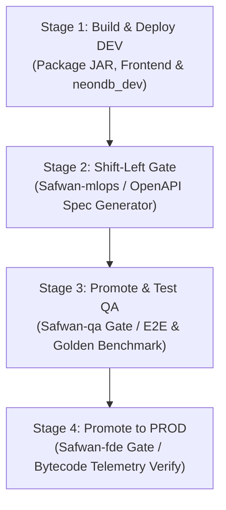

# CI/CD Pipeline, Deployment & Failure Troubleshooting Runbook

## 1. Multi-Stage Promotion Pipeline (`azure-pipelines.yml`)

AutoTriage runs an automated 4-stage multi-artifact promotion pipeline in Azure DevOps:

### Stage 1: Build & Deploy DEV (`neondb_dev`)
* **Environment**: `DEV` (`autotriage-backend-dev.graytree-645df5bf.eastus.azurecontainerapps.io`).
* **Steps**:
  1. Installs JDK 21 (`JavaToolInstaller@0`) and Node 22.x (`NodeTool@0`).
  2. Builds Spring Boot backend: `mvn clean package -DskipTests` in `sut/backend-spring/`.
  3. Bundles React frontend: `npm ci && npm run build` in `sut/frontend-react/`.
  4. Stages artifacts into `$(Build.ArtifactStagingDirectory)/artifact-dev/` including JAR, Flyway migrations (`V1`–`V4`), frontend `dist/`, and `env-manifest.json`.
  5. Publishes pipeline artifact: `autotriage-artifact-dev`.

### Stage 2: Shift-Left Agentic Spec & Test Gate
* **Gate Owner**: `Safwan-mlops`.
* **Execution**: Runs `python agent/src/autotriage/shift_left_generator.py` against `DEV_API_URL`.
* **Verification**: Extracts OpenAPI specs, verifies contract schemas against live endpoints, and generates synthetic defect contract tests (`test_shift_left_api_*.py`).

### Stage 3: Promote & Test QA (`env-qa` Approval Gate)
* **Gate Owner**: `Safwan-qa` (Manual approval required in Azure Pipelines Environments).
* **Environment**: `QA` (`autotriage-backend-qa.graytree-645df5bf.eastus.azurecontainerapps.io`, `neondb_qa`).
* **Execution**:
  1. Packages and publishes `autotriage-artifact-qa`.
  2. Runs full Playwright E2E regression: `pytest -v --junitxml=reports/qa-junit.xml` in `sut/e2e/`.
  3. Runs MLOps Golden Benchmark Gate: `python evals/eval_golden_dataset.py`, enforcing an automated pass threshold of `>= 95%`.

### Stage 4: Promote to PROD (`env-prod` Approval Gate)
* **Gate Owner**: `Safwan-fde` (Production release sign-off).
* **Environment**: `PROD` (`autotriage-backend-prod.graytree-645df5bf.eastus.azurecontainerapps.io`, `neondb_prod`).
* **Execution**:
  1. Packages and publishes `autotriage-artifact-prod`.
  2. Verifies live production health probe (`GET /api/products`) with `--connect-timeout 5`.
  3. Asserts scale-to-zero recovery (`minReplicas: 0`) and Application Insights bytecode telemetry linkage.

---

## 2. How to Read Test Reports & Telemetry Artifacts

### A. JUnit XML Test Results (`sut/e2e/reports/qa-junit.xml`)
Generated automatically on each test run. Inspect the following attributes:
* `<testsuite tests="72" failures="0" errors="0" time="45.2">`: Overall suite health.
* `<failure message="AssertionError: ...">`: Exact failure assertion.
* On failure, `conftest.py` attaches the screenshot path: `reports/screenshots/<test_name>_failure.png`.

### B. Golden Dataset Benchmark Summary (`evals/eval_golden_dataset.py`)
Outputs the evaluation score card:
* `Classification Accuracy: 100.0% (20/20)`
* `Path Routing Accuracy: 100.0% (P1-P8 exact match)`
* `False-Positive Developer Blame Rate: 0.0%`
* `RAG Citation Faithfulness: 100.0%`

### C. Azure DevOps Test Runs (`agent/src/autotriage/ado_test_publisher.py`)
Publishes results to Azure DevOps Test Plans under `TP-700` (`AB#82`):
* `totalTests`: Total test methods executed.
* `passedTests`: Count of green tests.
* `unanalyzedTests`: Tests requiring triage. Clicking the run URL displays the exact execution duration in milliseconds and stack trace.

---

## 3. Quorum Retry & Anti-Flake Strategy

To eliminate false-positive alert fatigue, AutoTriage applies deterministic retry policies:

1. **Playwright Anti-Flake Quorum (1 Isolated Retry Pass)**:
   * When a UI test fails due to a rendering timeout, AutoTriage isolates that single failed test and executes **exactly one immediate retry**.
   * If the retry passes:
     * Classification: `P5: Cannot Reproduce / FLAKY_TRANSIENT_TIMEOUT`.
     * Action: Records the flake event to the Test Health Telemetry dashboard. **Zero bug tickets are filed**, protecting the sprint burndown.
   * If the retry fails again:
     * Classification: `P6: Confirmed Bug`.
     * Action: Triggers AST RAG code localization and opens an ADO bug ticket.
2. **Container Cold-Start Probe Retries**:
   * Azure Container Apps configured with `minReplicas: 0` require 3–5 seconds to spin up on cold start.
   * Probes use `curl -s --connect-timeout 5` with 3 retries (5s backoff) before tagging an infrastructure outage (`P8`).

---

## 4. Failure Troubleshooting Playbooks

### Playbook 1: Maven Backend Build Fails (`mvn clean package`)
* **Symptom**: `[ERROR] Source option 21 is no longer supported` or compilation errors.
* **Diagnosis**: Check the active JDK version with `java -version`.
* **Fix**: Ensure Java 21 LTS is active. On local machines, run `export JAVA_HOME=$(/usr/libexec/java_home -v 21)`. In CI, verify the `JavaToolInstaller@0` task specifies `versionSpec: '21'`.

### Playbook 2: Flyway Migration Collides on Container Restart (`V2__seed.sql`)
* **Symptom**: `PSQLException: ERROR: duplicate key value violates unique constraint "products_pkey" Key (id)=(prod_001) already exists`.
* **Diagnosis**: Container restarted against an already-seeded database, executing raw `INSERT` statements.
* **Fix**: Verify `V2__seed.sql` includes `ON CONFLICT (id) DO NOTHING;` on all catalog seed inserts. Never modify previously executed migrations; author a new `V5` migration if schema changes are required.

### Playbook 3: CI Runner Environment Drift (`DRIFT-001` / `AB#34`)
* **Symptom**: Pytest fails with `ModuleNotFoundError: No module named 'rank_bm25'`.
* **Diagnosis**: The CI agent virtual environment lost dependency synchronization after a runner cache clear.
* **Triage Verdict**: AutoTriage flags as `ENVIRONMENT_DRIFT (P8)`. No developer bug is created.
* **Fix**: In the runner directory, execute `uv sync` to restore all locked dependencies from `uv.lock`.

### Playbook 4: Database Outage / Port 5432 Connection Refused
* **Symptom**: `httpx.ConnectError: [Errno 61] Connection refused` or JDBC `Connection to localhost:5432 refused`.
* **Diagnosis**: Local PostgreSQL container is stopped or cloud network security group blocked the port.
* **Triage Verdict**: AutoTriage classifies as `INFRA_OUTAGE (P8)`.
* **Fix**: Locally, run `docker compose up -d db`. In cloud environments, verify Neon serverless branch status and connection pooling limits.

### Playbook 5: Windows Launcher Execution Failure (`os error 4551`)
* **Symptom**: `uvicorn.exe` or `pytest.exe` fails with `os error 4551` on Windows environments.
* **Diagnosis**: Windows Smart App Control blocks executable launchers in virtual environments.
* **Fix**: Always execute tools as Python modules: `uv run -m pytest` or `uv run python <script.py>`.

### Playbook 6: Canary Rollback Gate Triggered Post-Deployment
* **Symptom**: `run_canary_validation()` returns `action: AUTOMATIC_REVISION_ROLLBACK`.
* **Diagnosis**: Container health check returned non-200 or synthetic canary tests failed during 10% traffic weight evaluation.
* **Action**: The canary gate rolls traffic back to the previous stable Azure Container App revision, bounds blast radius to 90%, calculates prevented revenue loss (e.g., $3,250.00 / 45 min downtime prevented), and logs the post-mortem summary directly to the ADO work item.
