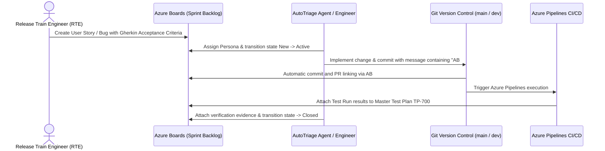

# Enterprise SAFe Agile Governance & Gherkin BDD Standards

## 1. SAFe Agile Release Train (ART) & Persona Roster

AutoTriage follows the Scaled Agile Framework (SAFe) operating model with dedicated engineering personas defined in Microsoft Entra ID (`isafwanoutlook.onmicrosoft.com`) and Azure DevOps (`https://dev.azure.com/isafwan/AutoTriage`).

To maintain strict enterprise role-based governance with zero cloud license spend ($0.00), the team leverages the Azure DevOps 5 Basic Users + Unlimited Stakeholders allocation rule:

| Persona | Role Title | Azure DevOps License | Environment Scope | Primary Responsibilities |
| :--- | :--- | :--- | :--- | :--- |
| **Safwan Saba (Owner)** | Release Train Engineer (RTE) / Solution Architect | Basic (Seat 1/5 Free) | ALL (`DEV`, `QA`, `PROD`) | Sprint governance, architecture review, billing guardrails, PR sign-off. |
| **`Safwan-dev`** | Senior Full-Stack Engineer | Basic (Seat 2/5 Free) | `DEV` & `QA` | Spring Boot 3.4 APIs, React 18 UI, unit tests, bug fixes on `dev` branch. |
| **`Safwan-qa`** | Lead SDET / QA Automation Engineer | Basic (Seat 3/5 Free) | `QA` Only | Python Playwright E2E suite (`sut/e2e`), regression sign-off, defect reproduction. |
| **`Safwan-devops`** | Cloud Infra & DevSecOps Engineer | Basic (Seat 4/5 Free) | `DEV`, `QA`, `PROD` (Infra) | Azure Container Apps, App Insights, multi-stage pipelines, runner health. |
| **`Safwan-mlops`** | AI / MLOps & Agent Engineer | Basic (Seat 5/5 Free) | `DEV`, `QA`, `PROD` (Agent) | LangGraph state machine, FastMCP KQL tools, golden dataset benchmark scoring. |
| **`Safwan-fde`** | Forward Deployed Engineer (FDE) | Stakeholder (Unlimited Free) | `PROD`, `QA`, `DEV` | Customer-facing delivery, production release gate approvals, incident triage. |

---

## 2. Board-First Operating Protocol & Traceability

Every piece of engineering work must link directly to an Azure Boards Work Item:



* **Branch Naming Standard**: `feature/AB#<ID>-<short-description>`, `fix/AB#<ID>-<short-description>`, or `release/v<version>`.
* **Commit Linking**: Every commit message must include the work item tag `AB#<ID>` (e.g., `Switch Flyway V2 seed script to idempotent insert strategy AB#42`).

---

## 3. Definition of Ready (DoR) & Definition of Done (DoD)

### Definition of Ready (DoR) Checklist
Before any work item is committed to a sprint backlog, it must satisfy:
- [ ] Parent Epic or Feature is explicitly linked.
- [ ] Assigned to a specific ART persona (`Safwan-dev`, `Safwan-qa`, etc.).
- [ ] Target environment specified (`DEV`, `QA`, or `PROD`).
- [ ] PRD or ADR reference attached (`PRD-001` through `PRD-006`, `ADR-001`, `ADR-008`).
- [ ] Acceptance criteria written in strict Gherkin `Given / When / Then` format.
- [ ] Story points estimated (Fibonacci scale: 1, 2, 3, 5, 8).

### Definition of Done (DoD) Checklist
Before any work item is marked `Closed` or `Resolved`, it must satisfy:
- [ ] Java backend unit and slicing tests pass (`mvn test`).
- [ ] Frontend builds without TypeScript or bundling errors (`npm run build`).
- [ ] Shift-Left OpenAPI contract verification passes on DEV (`shift_left_generator.py`).
- [ ] Playwright E2E regression passes with JUnit artifact generated (`reports/qa-junit.xml`).
- [ ] Golden Dataset benchmark passes with `>= 95%` accuracy (`eval_golden_dataset.py`).
- [ ] Automated Test Run published under Master Test Plan `TP-700` (`ado_test_publisher.py`).
- [ ] Zero hardcoded credentials, zero local absolute paths, and zero emojis committed.

---

## 4. Mandatory Work Item Structure & Gherkin Templates

### A. Feature / User Story Template
```markdown
# Title: [US-XXX] <Concise Feature Summary>

## User Story Statement
As a <user role>,
I want to <capability / action>,
So that <business outcome / benefit>.

## Architectural References
- Target Environment: DEV / QA / PROD
- Related PRD / ADR: PRD-001 (Order Processing) / ADR-008 (Stock Reservation)
- Assigned Persona: Safwan-dev
- Automated Test Mapping: sut/e2e/tests/test_checkout.py::test_checkout_funnel

## Acceptance Criteria (Gherkin BDD)
Feature: Order Checkout Invariants

  Scenario: Standard order placement with sales tax and free shipping
    Given a customer with an active authenticated session
    And a shopping cart containing products with subtotal $100.00
    When the customer submits a checkout request with valid shipping details
    Then the system calculates 10% sales tax resulting in $10.00
    And the system applies free shipping of $0.00
    And the final order total is recorded as $110.00
    And product inventory stock is decremented atomically
```

### B. Test Case Template (`TP-700` Master Test Plan)
```markdown
# Title: [TC-XXX] Verify Atomic Inventory Decrement During Concurrent Checkout

## Preconditions
- System Under Test is running and healthy at /actuator/health.
- Product "prod_008" exists with stock = 8.
- Test fixture credentials loaded from sut/e2e/data/sut_test_data.json.

## Test Scenario (Gherkin Outline)
Scenario Outline: Inventory depletion under simultaneous orders
  Given product <product_id> has available stock of <initial_stock>
  When <thread_count> concurrent customers place an order for quantity <order_quantity>
  Then exactly <successful_orders> orders succeed with HTTP 201 Created
  And the remaining <failed_orders> orders fail with HTTP 409 Conflict
  And final database stock for <product_id> equals <final_stock>

  Examples:
    | product_id | initial_stock | thread_count | order_quantity | successful_orders | failed_orders | final_stock |
    | prod_008   | 8             | 10           | 1              | 8                 | 2             | 0           |
```

### C. Triaged Bug Ticket Template (`$Bug` via WorkItems MCP)
```markdown
# Title: [PRICE_INJECTION] Missing Server-Side Price Assertion in OrderController

## Classification & Priority
- Priority: 1 (Critical)
- Severity: 1 - Critical
- Decision Path: P6 (Confirmed Code Bug)
- W3C Trace ID: 4bf92f3577b34da6a3ce929d0e0e4736

## Physical Root-Cause Grounding
- File: sut/backend-spring/src/main/java/com/autotriage/shop/controller/OrderController.java
- Line Range: 101-116
- AST Symbol: OrderController.createOrder()
- Assigned Code Owner: active-backend-engineer@autotriage.local

## Gherkin Reproduction Steps
Scenario: Exploitation of unverified client cart price payload
  Given an authenticated customer with item "prod_008" in cart
  When a mutated payload with price $0.01 is sent to POST /api/orders
  Then OrderController accepts the request without validating against catalog price $2,500.00
  And the order is created with total $0.01 instead of rejecting with HTTP 400 Bad Request

## Financial & Operational Blast Radius
- Financial Impact: Arbitrage loss of $2,499.99 per unit.
- Recommended Remediation: Add server-side price lookup against ProductRepository before invoice generation.
```
