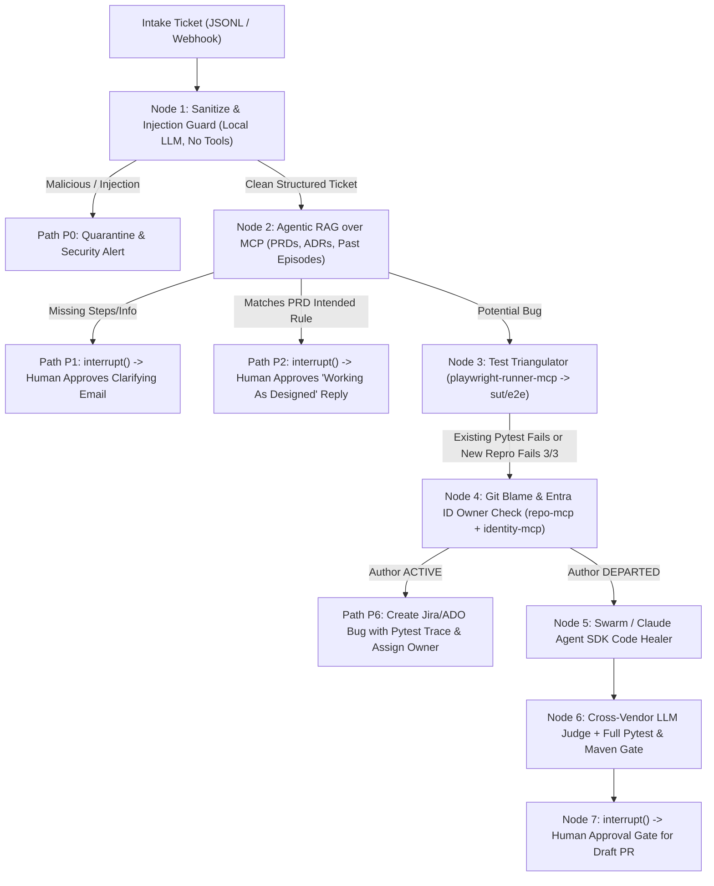

# AutoTriage — FDE Agentic Architecture, Harness Engineering & RAG Blueprint

This document maps your **7 Forward Deployed Engineer (FDE) / Applied AI Engineering Pillars** directly to concrete code, JSON/JSONL datasets, and architectural patterns in `/Users/lion/Projects/autotriage`.

---

## Pillar 1: JSON Test Data & Agentic RAG Over MCP Using Vector Datastores

### Why JSONL (`rag_knowledge_chunks.jsonl`) is Best for Agentic RAG
Standard naive RAG splits markdown or PDFs by arbitrary character counts (e.g., 500 tokens), which breaks tables, loses route mappings, and causes hallucinations when an agent tries to decide if behavior is **Working As Designed (Path P2)** vs. a **Confirmed Regression (Path P3/P7)**.

For **Agentic RAG**, we use **hybrid metadata-enriched JSONL chunks** (`knowledge/corpus/rag_knowledge_chunks.jsonl`) stored in **PostgreSQL + `pgvector`** and exposed via the **`rag-mcp`** server:
1. **Deterministic Metadata Filtering + Dense/Sparse Hybrid Search:**
   - Every JSONL record carries explicit metadata: `doc_id` (`PRD-001`), `doc_type` (`prd`, `adr`, `sprint_notes`), `related_routes` (`["/checkout/summary", "POST /api/orders"]`), and `related_test_ids` (`["tests/test_checkout.py::..."]`).
   - When a ticket mentions `/checkout`, the agent calls `rag-mcp.search_knowledge(query, route_filter="/checkout")`, combining **BM25 keyword match** (exact route/error text) + **pgvector cosine similarity** + **cross-encoder reranking**.
2. **Long-Term Agentic Memory (Episodic + Semantic):**
   - **Semantic Memory (`knowledge_chunks` table):** PRDs, ADRs, and sprint ownership notes (`knowledge/corpus/rag_knowledge_chunks.jsonl`).
   - **Episodic Memory (`resolved_triage_episodes` table in pgvector):** Every time AutoTriage resolves a ticket and a human approves the outcome, the final `{symptom_embedding, root_cause_file, winning_pytest_nodeid, patch_diff}` is written back to `pgvector` via `rag-mcp.store_episode()`, giving the agent **long-term institutional memory** of past incidents.

---

## Pillar 2: Harness Engineering with LangChain, Deep Agents & Claude Agent SDK

Instead of stuffing every task into one monolithic prompt, AutoTriage uses **specialized Agent Harnesses** orchestrated by LangGraph:

| Harness Role | Framework / SDK | Why This Harness Is Used | Tools Allowed (via MCP) |
| :--- | :--- | :--- | :--- |
| **1. Quarantined Intake Parser** | **LangChain Structured Output (`Pydantic v2`)** | Runs with **zero tools** (`bind_tools([])`) to parse untrusted customer emails into `SanitizedTicketSchema` and detect prompt injection (breaking the Lethal Trifecta). | **None** (Tool-less sandbox) |
| **2. Deep Research & Test Triangulator** | **LangChain + Deep Agents Planner** | Multi-hop reasoning over `rag-mcp` (PRDs/ADRs) and `playwright-runner-mcp` (`sut/e2e` pytest suite) to decide if behavior is intended (`P2`), covered by an existing test (`P3`/`P4`), or needs a newly synthesized `pytest-playwright` reproduction script (`P5`). | `rag-mcp`, `playwright-runner-mcp`, `log-collector-mcp` |
| **3. Autonomous Code Healer** | **Claude Agent SDK** | Purpose-built agentic coding harness for reading Java Spring Boot / React ASTs, localizing the fault in `OrderController.java` or `CartController.java`, applying a minimal surgical diff, and running `mvn verify` + `pytest` in a loop until green. | `repo-mcp` (scoped to `sut/`), `playwright-runner-mcp` |

---

## Pillar 3: Model Routing — Frontier vs. Open-Source vs. Local LLMs

Implemented in `agent/src/autotriage/models/router.py`, the **Model Router** selects the optimal model per graph node based on **intelligence, latency, token cost, and data privacy**:

| Graph Node / Task | Primary Model | Fallback / Alternative | Selection Rationale (Intelligence / Speed / Cost / Privacy) |
| :--- | :--- | :--- | :--- |
| **PII Redaction & Injection Guard (`sanitize_node`)** | **Local LLM (`Ollama: Llama-3.2-3B` or `Qwen-2.5-7B`)** | `gpt-4o-mini` / `claude-3-5-haiku` | **Privacy & Cost:** Untrusted customer PII never leaves the VPC before scrubbing; sub-100ms local inference at $0 token cost. |
| **RAG Classification & Triage Routing (`rag_check_node`)** | **Fast Frontier / Open-Weights (`gpt-4o-mini` or `Llama-3.3-70B` via Bedrock/Groq)** | `gpt-4o` | **Speed & Cost:** Structured classification (`P1`/`P2`/`P3`) with grounded PRD citations requires high speed and low cost (~$0.002/ticket). |
| **Playwright Test Synthesis & Java/React Code Healing (`healer_node`)** | **Frontier Coding Model (`Claude Sonnet 4.6` via Anthropic / AWS Bedrock)** | `gpt-4o` | **Max Intelligence:** Writing flake-free `pytest-playwright` code and surgical Spring Boot patches requires top-tierSWE-bench reasoning. |
| **Independent Patch & RCA Judge (`judge_node`)** | **Cross-Vendor Frontier (`Azure OpenAI o3-mini / gpt-4o`)** | `Gemini 2.5 Pro` | **Vendor Diversity:** Never use the same model family to judge a patch that generated the patch (ADR-010); eliminates correlated blind spots. |

---

## Pillar 4: Durable Workflows in LangGraph (State, Crash Recovery & HITL)

The core workflow in `agent/src/autotriage/graph/` is built on **LangGraph** with **`PostgresSaver` checkpointer**:

- **Durable State & Crash Recovery:** Every node transition is checkpointed by `thread_id` (`ticket_id`) into PostgreSQL. If a pod restarts mid-Playwright run, `graph.invoke(None, config={"configurable": {"thread_id": "TKT-101"}})` resumes from the exact last completed node without re-running earlier LLM calls.
- **Human-in-the-Loop (`interrupt()`):** Customer-facing emails (`P1`, `P2`) and GitHub/ADO Draft PR creation (`P7`) call LangGraph's `interrupt()`, pausing execution until a reviewer approves, edits, or rejects via API/CLI.

---

## Pillar 5: Scaling with Agent Swarms, LLM-as-a-Judge & Recursive Self-Improvement

1. **Parallel Diagnostic Swarm (`Send()` API in LangGraph):**
   - When `Test Triangulator` confirms a failure, LangGraph fans out in parallel to a **3-agent diagnostic swarm**:
     - **UI Trace Analyst:** Inspects `sut/e2e/reports/pytest-report.json` and DOM snapshots.
     - **Backend Log & Stacktrace Analyst:** Queries Spring Boot actuator/application logs via `log-collector-mcp`.
     - **Git Blame & History Analyst:** Queries recent commits and author status via `repo-mcp` and `identity-mcp`.
2. **Cross-Vendor LLM-as-a-Judge (`judge_node`):**
   - Evaluates the Healer's proposed patch against a 4-point rubric: *(1) Does the new/existing `pytest` test pass? (2) Do all 19 regression tests in `sut/e2e` pass? (3) Does the diff touch only allowed files and < 50 lines? (4) Does the RCA cite the exact PRD/code line?*
3. **Recursive Self-Improvement Loop:**
   - If the Judge rejects a patch or a regression test fails, the Judge's structured critique + compiler/pytest traceback is fed back into the Healer (`max_iterations = 3`).
   - Once approved by a human, the winning reproduction test is permanently promoted into `sut/e2e/tests/` and the episode is indexed into `pgvector`, making the system smarter on every subsequent ticket.

---

## Pillar 6: Evals & Observability in Langfuse to Drive Architecture & Business Outcomes

Every LangGraph run is traced with **OpenTelemetry + Langfuse** and gated in CI by **`evals/datasets/triage_tickets_golden.jsonl`**:

- **Technical Eval Metrics (CI Gate):**
  - **Path Routing Accuracy:** Must match `expected_path` (`P0`, `P1`, `P2`, `P7`) on `triage_tickets_golden.jsonl` ($\ge 90\%$).
  - **RAG Citation Precision & Faithfulness (RAGAS / DeepEval):** Must cite the exact `expected_rag_citation` (`PRD-001`..`PRD-004`) with zero hallucinated policies.
  - **Bug Reproduction Rate:** Must deterministically fail when the corresponding runtime bug flag is `True` and pass when `False`.
- **Business Outcome Metrics (Tracked in Langfuse Dashboards):**
  - **Median Time-to-Triage (MTTT):** Measured in seconds from ticket intake to verified RCA / Draft PR.
  - **Cost per Triaged Ticket ($):** Tracked per model tier (Local Ollama vs. Haiku/Mini vs. Sonnet/o3-mini) so architecture changes (e.g., caching RAG chunks or routing simple tickets to smaller models) immediately show ROI.
  - **False-Escalation Rate:** Percentage of `Working As Designed` tickets (`TKT-104`, `TKT-105`) mistakenly escalated to engineering (target: $0\%$).

---

## Pillar 7: Client Delivery — Discovery, Governance, Responsible AI & Handover

To lead AI initiatives end-to-end as an FDE with enterprise clients, the repository includes:
1. **Discovery & Baseline Measurement (`docs/discovery.md`, `docs/metrics.md`):** Defines the client's current manual bug-triage workflow, baseline MTTT, and the Claim Ladder (never claiming unmeasured ROI).
2. **Governance & Responsible AI (`docs/rai-checklist.md`):**
   - **No Autonomous Merge (ADR-006):** Agent can only open Draft PRs; human approval token required.
   - **Prompt Injection Defense (ADR-007):** Tool-less quarantine parser verified by `TKT-107` and `promptfoo` red-team suite.
   - **Protected Path Denylist:** Healer is blocked at the MCP gateway from modifying `SecurityConfig.java`, `JwtService.java`, Flyway migrations, or CI pipelines.
3. **Operational Runbook & Client Handover (`docs/runbook.md`, `docs/handover.md`):** Covers Langfuse alert thresholds, model fallback switching, and how client QA/SWE teams add new PRDs to `knowledge/corpus/` and new `pytest` specs to `sut/e2e/`.
