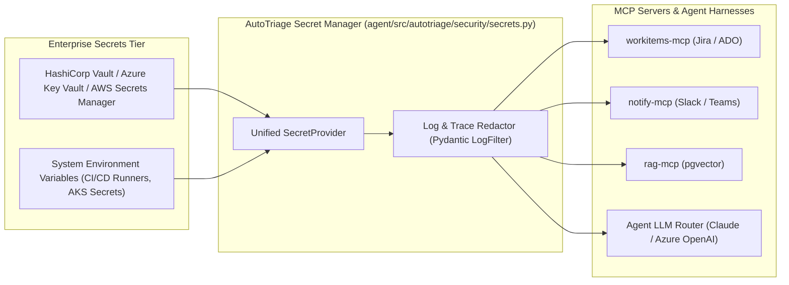

# AutoTriage — Enterprise Secrets Management & MCP Channel Architecture

This document outlines the **Secrets Architecture (Vault/KMS)** and the **MCP Gateway Integrations (Jira/ADO, Slack/Teams, Playwright, RAG)** for AutoTriage.

---

## 1. Enterprise Secrets Management Architecture (Zero Plaintext Secrets)

As we introduce **Azure OpenAI**, **Anthropic/AWS Bedrock**, **Jira Cloud / Azure DevOps**, **Slack Webhooks / Teams**, and **Langfuse**, secrets must **never** be committed to Git, stored in `.env` files within repositories, or printed in logs.

### Key Principles:
1. **Three-Tier Secrets Hierarchy:**
   - **Local Development:** Developers set environment variables or use a local Dockerized HashiCorp Vault (`http://localhost:8200`) or pass file `~/.autotriage/secrets.env` (kept strictly in user `$HOME`, never inside project directory).
   - **CI/CD Pipeline (Azure Pipelines / GitHub Actions):** Injected as masked secrets into the runner environment.
   - **Production (AKS / Cloud):** Mounted via **Azure Key Vault Provider for Secrets Store CSI Driver** or **HashiCorp Vault Agent Sidecar**, mapping secrets directly into memory.
2. **Pydantic `SecretStr` + Auto-Masking:**
   - All credentials use `pydantic.SecretStr` in Python. They cannot be accidentally printed in console logs or serialized into Langfuse traces.
3. **MCP Gateway Guard (Role-Based Tool Authorization):**
   - The agent never receives raw Jira or Slack API tokens. Instead, the agent invokes tool calls (`create_bug_ticket`, `send_triage_notification`) through the **MCP Gateway**, which securely attaches credentials out-of-band.

---

## 2. Next Step Plan: MCP Servers & Ticket/Notification Channels

The upcoming phase implements the **4 core MCP Servers** under `mcp_servers/`:

### A. `mcp_servers/workitems/` (Jira Cloud + Azure DevOps Adapter)
- **Purpose:** When AutoTriage confirms a regression bug (Path P6/P7), it automatically files an engineering bug ticket with structured reproduction steps, Playwright traces, failure screenshots, and Git blame analysis.
- **Contract / Tools:**
  - `workitems_create_bug(title, description, severity, repro_steps, trace_file, assignee)`
  - `workitems_get_ticket(ticket_id)`
  - `workitems_update_ticket_status(ticket_id, status, pr_url)`
- **Adapter Pattern:**
  - A single interface supporting either **Jira Cloud REST API v3** (using Atlassian API Token) or **Azure DevOps (ADO) Boards** (using ADO PAT), swappable via `WORKITEMS_PROVIDER=jira` or `WORKITEMS_PROVIDER=ado`.

### B. `mcp_servers/notify/` (Slack + Microsoft Teams)
- **Purpose:** Sends human-in-the-loop (HITL) triage digests and approval requests for customer replies or Draft PR reviews.
- **Contract / Tools:**
  - `notify_send_triage_alert(channel, ticket_id, summary, confidence_score, action_required)`
  - `notify_request_approval(ticket_id, diff_summary, approval_token)`
- **Integrations:**
  - **Slack:** Incoming Webhook + Block Kit interactive card.
  - **Microsoft Teams:** Adaptive Card via Office 365 Connector or Power Automate Webhook.

### C. `mcp_servers/playwright_runner/` (Existing SUT Bridge)
- Bridges the Python LangGraph triage agent directly to our verified `sut/e2e` suite:
  - `run_existing_test(nodeid)`: Executes targeted test in `sut/e2e/tests/`.
  - `run_repro_test(test_code)`: Runs agent-synthesized reproduction tests in an isolated sandbox.
  - `run_full_regression()`: Executes all 21 tests to verify zero side-effects.

### D. `mcp_servers/rag/` (Knowledge & Past Episodes)
- Serves semantic PRD/ADR chunks (`knowledge/corpus/rag_knowledge_chunks.jsonl`) and past triage episodes from `pgvector`.
